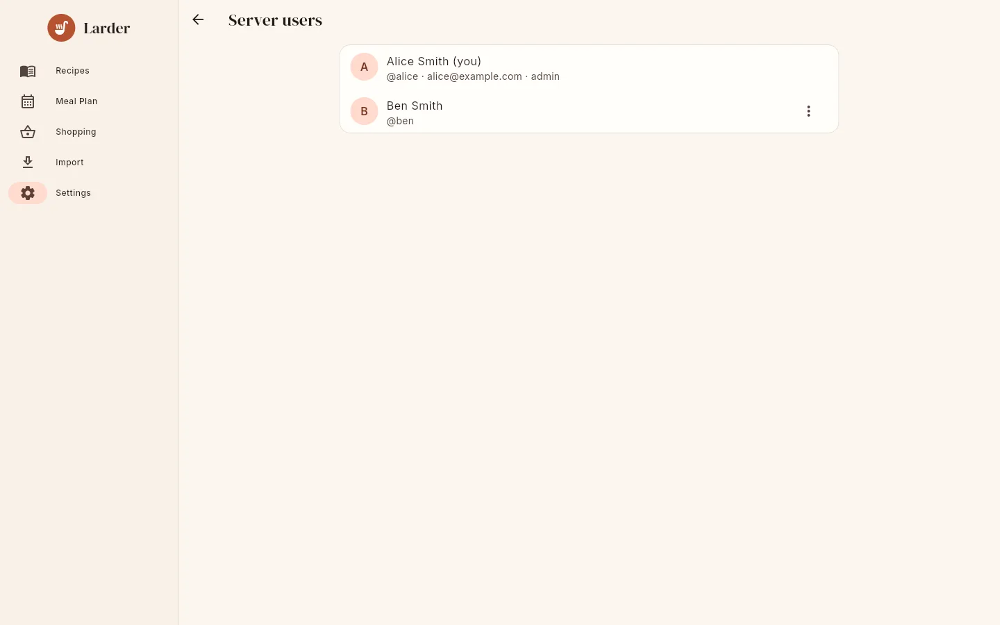

# Users & administration

Larder has two independent kinds of privilege:

| | Scope | How you get it |
|---|---|---|
| **Server admin** | The whole server: all accounts | First account on the server; promoted by another admin; or membership in `LARDER_OIDC_ADMIN_GROUP` |
| **Household owner** | One household: its name, invites and members | Creating a household (first account, open registration, SSO without invite, being removed from a household); promoted by another owner |

A server admin is not automatically an owner of other households and cannot see their
recipes. An owner has no server-wide powers.

## How people get accounts

| Situation | Result |
|---|---|
| No users exist yet | The first registration becomes **server admin** and **owner** of a new household. |
| Registering with a valid invite code | **Member** of the inviting household. |
| Registering without a code, `LARDER_ALLOW_REGISTRATION=true` | **Owner** of a new household. |
| Registering without a code, registration closed (default) | Refused: "registration is closed; ask a household owner for an invite code" (the app shows "Registration is closed. Ask the household owner for an invite code."). |
| First SSO sign-in | See [OIDC accounts](oidc.md#accounts). |

New households are named "*Display name*'s Kitchen".

## The Server users screen

Server admins see **Settings → Server users** ("Administer all accounts"). It lists every
account on the server, sorted by username, with display name, `@username`, email, and
**admin** / **disabled** markers.

{ .screenshot }

The **⋮** menu on each user (not on yourself) has:

| Action | Effect |
|---|---|
| **Make admin** / **Remove admin** | Grants or revokes server admin. |
| **Disable account** / **Enable account** | A disabled user cannot sign in ("this account is disabled") and all their sessions are revoked immediately; their next request fails. Their data stays. |
| **Reset password** | Sets a new password (at least 8 characters) and signs them out everywhere. Use this when someone forgets their password; there is no email-based reset. |
| **Delete user** | After "This cannot be undone." confirmation: deletes the account, their favourites and sessions. If they were the last member of their household, the household is deleted with **all its recipes, photos, meal plan and lists**. If they were its only owner, the longest-standing remaining member becomes owner. |

You cannot demote, disable or delete yourself, so a server always keeps at least the admin
doing the work.

Admins cannot change which household a user is in from this screen; household owners do that
by inviting and removing members.

## Household owners

Owners manage their household in **Settings → Household**: rename it, create and revoke
invites, make members owners or members, and remove members (who are moved to a new household
of their own). See [Households & sharing](../guide/households.md).

A household always keeps at least one owner: the last owner cannot demote themselves, and
when an owner's account is deleted another member is promoted.

## Recovering access

- **A user forgot their password**: an admin uses **Reset password**.
- **The only admin forgot their password**: there is no command-line reset. If the admin
  account is linked to SSO, sign in with SSO and set a new password. Otherwise you have to
  edit the database: stop the server, back it up, and either set `is_admin = 1` on another
  user in the `users` table or put a known argon2 hash (for example from the `argon2` command
  line tool, PHC string format) into the admin's `password_hash`.
- **An SSO user lost access to the provider**: an admin can **Reset password** to give the
  account a password.
