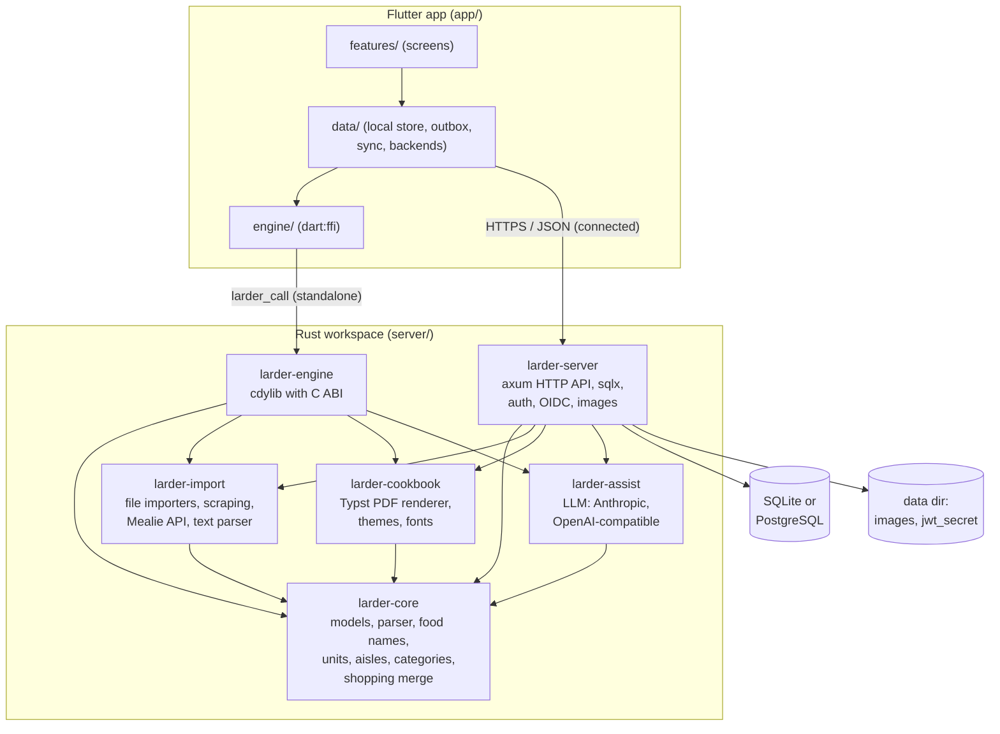
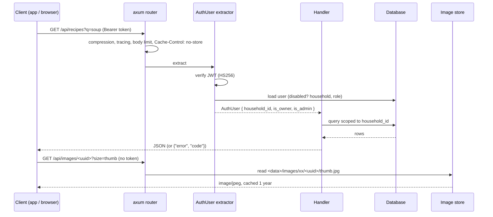
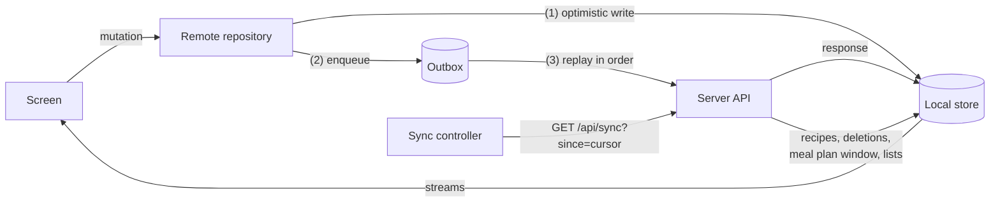
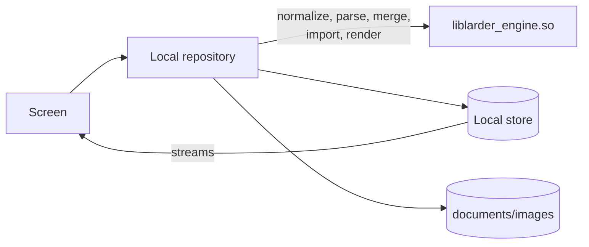

# Architecture

## Crates and components

- **larder-core** has no I/O. Everything that must behave identically on the server and the
  phone lives here: `RecipeData::normalize`, the ingredient parser (`parse.rs`), food-name
  normalisation and food keys (`food.rs`, `Ingredient::canonicalize`), unit conversion and
  formatting (`units.rs`, `format.rs`), aisle classification (`aisle.rs`), category
  suggestions (`categorize.rs`) and `merge_recipes` / `tidy_amount` (`shopping.rs`). The
  Flutter app ports the unit and formatting code to Dart (`app/lib/util/units.dart`,
  `scaling.dart`) so on-screen amounts match the server and the PDF.
- **larder-import** turns files, URLs and text into `ImportedRecipe`s. It does the network
  fetching for URL and Mealie imports and has the zip-bomb and path-traversal protections.
- **larder-cookbook** builds a JSON book model from recipes and options and compiles a Typst
  template against it in an in-memory `World` (no disk or network access).
- **larder-assist** wraps the LLM providers with structured JSON output.
- **larder-server** is the axum application: routes, a `sqlx::AnyPool` over SQLite or
  PostgreSQL (separate migration sets, a shared SQL subset), the image store, auth and OIDC.
  It has two HTTP clients: a normal one for OIDC and the AI provider, and a guarded one
  (`netguard.rs`) for user-supplied URLs, whose DNS resolver and redirect policy refuse
  loopback, link-local and unspecified addresses.
- **larder-engine** exposes the same libraries to the app via
  `larder_call(method, json) -> json`; see [On-device engine](../reference/engine.md).

## Request flow on the server

- Routes live under `/api` (`routes/*.rs`). `/healthz` answers `ok`. Everything else is served
  from `LARDER_WEB_DIR`, falling back to `index.html` for client-side routes.
- Errors are `AppError`s rendered as `{"error": "...", "code": "..."}` with the right status.
- CPU-heavy work (image decoding, file parsing, PDF rendering) runs in
  `spawn_blocking`. Bulk imports run as background tasks that update an `import_jobs` row
  every few recipes.
- At start-up the server connects, runs migrations and marks unfinished import jobs as failed.

## Data in the app

All reads in the app come from a local [sembast](https://pub.dev/packages/sembast) store
(`app/lib/data/local_store.dart`) with stores for recipes, the meal plan, shopping lists, the
outbox and metadata. Riverpod providers stream from it, so the UI updates when the store
changes. Search, filtering and sorting are always done locally.

`backendProvider` picks the implementation of the repositories (recipes, meal plan,
shopping, imports, cookbook) from the current mode.

### Connected mode

1. A mutation is applied to the local store immediately and queued in the persistent outbox
   with a client-generated UUID, so replays are idempotent.
2. The outbox is replayed in order (`outbox.dart`): success applies the response; `409`
   re-fetches the server version (server wins) and emits a notice; other `4xx` drop the
   operation with a notice and trigger a sync; network errors and `5xx` stop and retry later
   (5xx up to 5 attempts); `401` stops.
3. `SyncController` pushes the outbox, then pulls `GET /api/sync?since=<cursor>` on start,
   resume, connectivity regained, pull-to-refresh and every 45 s while operations are
   pending. If new operations were queued during the pull, the snapshot is not applied, so
   it never overwrites optimistic changes.
4. `ApiClient` adds the bearer token and, on `401`, refreshes the token once (single-flight
   for concurrent requests) and retries.

Online-only operations (photos, imports, PDFs, admin) call the API directly through
`SyncController.online`, which tracks online/offline state.

### Standalone mode

The local repositories call the engine for everything the server would do and write results
straight into the store. Photos are processed into three JPEG sizes under
`<documents>/images`. There is no outbox. The engine is loaded only on Android (conditional
imports keep `dart:io` and `dart:ffi` out of the web build).

### Switching modes

- **Connect later** (`data/migration.dart`): uploads recipes (same ids), photos, favourites,
  meal plan entries, lists and items, recording progress in the store so it can resume; then
  switches to connected and does a full sync.
- **Disconnect** (`features/settings/mode_settings.dart`): flushes the outbox, downloads every
  photo through the engine's `process_image`, switches to standalone and signs out, keeping
  the store.

## The app's routes

`/welcome`, `/setup-server`, `/login`, `/oidc-callback`, `/connect`, `/connect/login`,
`/connect/migrate`, `/recipes`, `/recipes/new`, `/recipes/:id`, `/recipes/:id/cook`,
`/recipes/:id/edit`, `/mealplan`, `/shopping`, `/shopping/:id`, `/import`, `/cookbook`,
`/settings`, `/settings/household`, `/settings/admin`.

A pure redirect function (`appRedirect` in `router.dart`) sends unset Android installs to
`/welcome`, connected users without a server to `/setup-server`, signed-out users to
`/login`, and keeps standalone users out of the sign-in screens. The web build uses path URLs
(not `#/`) so OIDC can return to `/oidc-callback#tokens`.

## Database schema

One migration set per backend (`server/crates/server/migrations/{sqlite,postgres}`) creates
equivalent schemas: `households`, `users`, `refresh_tokens`, `invites`, `recipes` (JSON
columns for ingredients, instructions, tags, categories and nutrition, plus `search_text`,
`name_lower` and a `version`), `recipe_tags`, `favorites`, `deleted_recipes` (tombstones for
sync), `meal_plan`, `shopping_lists`, `shopping_items` and `import_jobs`. Timestamps are
fixed-width RFC 3339 text so they sort as strings on both backends.
