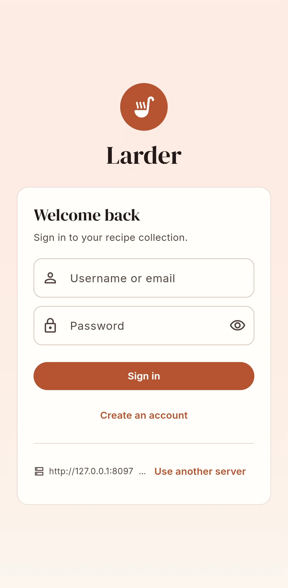

# Install the Android app

Larder is not on the Play Store. You install the APK yourself ("sideloading").

| | |
|---|---|
| App name | Larder |
| Application ID | `io.github.larrydewey.larder` |
| Minimum Android version | Android 6.0 (API 23) or the Flutter minimum, whichever is higher |
| Permissions | Internet, network state, vibration (for timers) |

## Download the APK

=== "GitHub Releases (recommended)"

    Every tagged release (`v*`) publishes one APK per CPU architecture on the repository's
    **Releases** page:

    | File | For |
    |---|---|
    | `app-arm64-v8a-release.apk` | Almost all current phones (64-bit ARM) |
    | `app-armeabi-v7a-release.apk` | Older 32-bit ARM phones |
    | `app-x86_64-release.apk` | Emulators and x86 Chromebooks |

    If unsure, take `arm64-v8a`.

=== "CI artifact (latest development build)"

    Every push to the main branch runs the CI workflow, which uploads an artifact named
    **larder-android-apk** containing a single universal `app-release.apk`. Open the
    repository's **Actions** tab, pick the latest successful **CI** run and download the
    artifact (you need to be signed in to GitHub). Unzip it to get the APK.

=== "Build it yourself"

    See [Building from source](../development/building.md#android). You need Flutter, Rust,
    `cargo-ndk` and the Android NDK.

## Install it

1. Copy the APK to the phone, or download it directly in the phone's browser.
2. Open it. Android asks you to allow the app you opened it from (your browser or file
   manager) to **Install unknown apps**. Allow it for that app, go back and tap **Install**.
3. Open **Larder**.

!!! warning "Updating between builds"

    Android only installs an update over an existing app when both are signed with the same
    key. Release APKs are signed with the project's release key, so each release updates the
    previous one. CI artifacts (and releases of forks built without signing secrets) are
    signed with a throw-away debug key instead and cannot update a release install, or the
    other way round: you get "App not installed". In that case, export a backup first
    (standalone) or make sure your changes are synced (connected), uninstall, and install the
    new APK.

## First launch

The first screen, **Welcome to your larder**, asks how you want to use the app:

**Use on this device**
:   "No account or server needed. Everything stays on this phone." The app checks that the
    on-device engine (`liblarder_engine.so`) loads. If it does not (for example a build made
    without the engine), you see **On-device mode unavailable** with the reason, and you can
    still connect to a server. See [Standalone mode](../guide/standalone.md).

**Connect to a server**
:   "Sync with your self-hosted Larder server and share with your household." You are taken
    to **Connect to your kitchen**.

### Connecting to a server

Enter the **Server URL**, for example `http://192.168.1.10:8080` or
`https://recipes.example.com`, and tap **Connect**.

- If you leave out `http://` or `https://`, `http://` is assumed. A trailing `/` or `/api` is
  removed.
- Plain `http://` works for servers on your home network ("Plain http:// works for servers on
  your home network.").
- The app checks the address by calling `GET /api/config`. If nothing answers you see "Could
  not reach a Larder server at that address."; if something answers that is not Larder you see
  "That does not look like a Larder server (...)".
- **Use on this device instead** switches to standalone mode.

After connecting you see the sign-in screen. See [First steps](first-steps.md). On Android the
link at the bottom, next to the server address and version, reads **Change** (on the web it
reads **Use another server**, as in this phone-sized screenshot of the web app).

{ .screenshot }

!!! tip "Single sign-on on Android"

    If the server has OIDC enabled, **Sign in with …** opens the identity provider in a
    browser tab. After you sign in, the provider sends you back to the app through the
    `larder://auth` link. See [Single sign-on](../admin/oidc.md).
