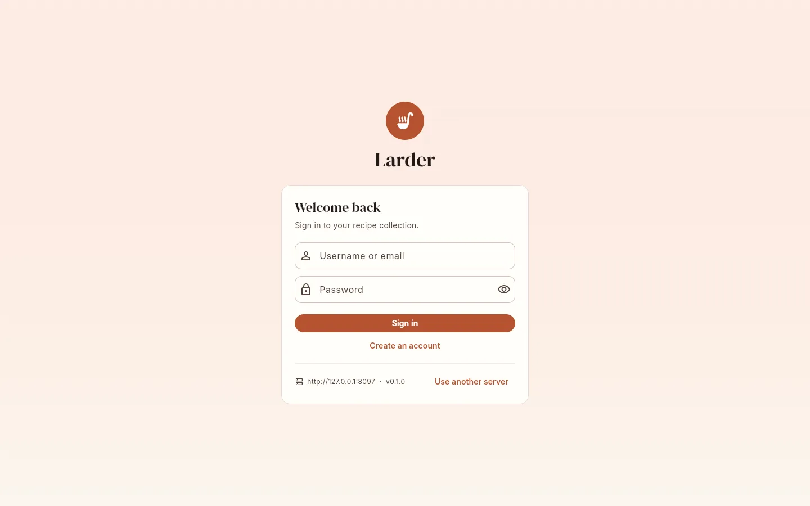
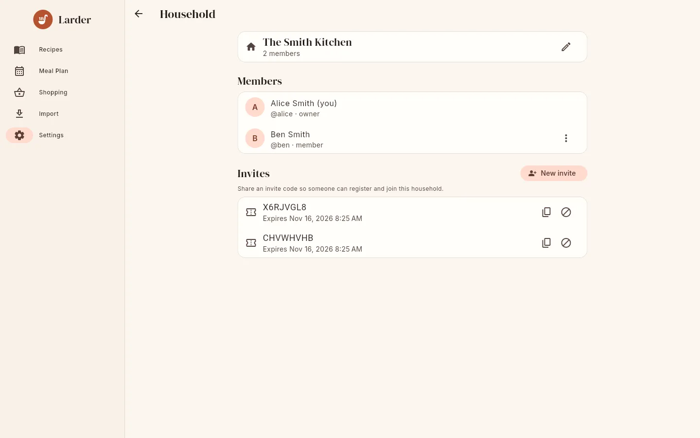

# First steps

This page assumes a running server. For a phone without a server, see
[Standalone mode](../guide/standalone.md); everything about recipes, meal plans and imports
works the same.

## 1. Create the administrator account

Open the server in a browser (or connect the Android app to it). On a fresh server the sign-in
screen says **Create admin account**: "This server has no users yet. The first account becomes
the server administrator."

{ .screenshot }

Fill in:

| Field | Rules |
|---|---|
| **Username** | 2 to 64 characters: letters, numbers, `_`, `-`, `.` and `@`. Case-insensitive and unique. |
| **Password** | At least 8 characters. |
| **Display name** | Optional; defaults to the username. |
| **Email (optional)** | Must contain `@`. You can sign in with it instead of the username. Used to link single sign-on accounts. |

The first account becomes a **server admin** and the **owner** of a new household called
"*Display name*'s Kitchen". You can rename it later.

## 2. Invite your family

Registration is closed by default: only the first account and people with an invite code can
sign up.

1. Go to **Settings → Household**.
2. Under **Invites**, tap **New invite** and choose how long it is valid: **1 day**, **7 days**
   or **30 days**.
3. The 8-character code (for example `X6RJVGL8`) is copied to your clipboard. Send it to the
   person you are inviting. Codes avoid look-alike characters (no `0`, `O`, `1` or `I`).

{ .screenshot }

They open your server, tap **Create an account**, fill in the form including **Invite code**,
and tap **Create account**. They join your household as a **member** and see all its recipes,
meal plans and shopping lists. An invite code can be used more than once until it expires or
you **Revoke** it.

!!! tip "Joining with single sign-on"

    If you use OIDC, the invitee taps **Create an account**, enters the **Invite code**, then
    taps **Sign in with …** instead of filling in a password. The code is passed through the
    sign-in so their new account joins your household. See [OIDC](../admin/oidc.md).

If `LARDER_ALLOW_REGISTRATION=true`, anyone can register without a code; each such person
gets a new household of their own as owner.

## 3. Import your first recipes

Go to **Import** in the navigation bar.

- **Website**: paste a link to a recipe page and tap **Preview & edit** (check it, then **Save**)
  or **Import directly**.
- **File**: choose an export from Mealie, Tandoor, Paprika, Nextcloud Cookbook, Recipe Keeper,
  a schema.org JSON file or a Larder backup. Leave **Source** on **Detect automatically**.
- **Mealie**: copy everything straight from a running Mealie server with an API token.
- **Text**: paste a recipe from an email or document.
- **Photo** (only when AI assist is enabled): photograph a recipe card.

See [Importing recipes](../guide/importing.md) for a walkthrough of each source.

## 4. Set your preferences

In **Settings → Preferences**:

- **Units**: **Original**, **Metric** or **Imperial**. This is the default for every recipe you
  open (you can still switch per recipe). It is saved in your profile on the server.
- **Theme**: **System**, **Light** or **Dark** (saved on this device).

## 5. Install the app on your phone

[Install the Android app](android.md), choose **Connect to a server** and sign in. Your recipes
are cached on the phone for offline use.

## Where to go next

- [Recipes](../guide/recipes.md) and [Editing recipes](../guide/editing.md)
- [Meal planner](../guide/meal-plan.md) and [Shopping lists](../guide/shopping.md)
- [Printable cookbook](../guide/cookbook.md)
- [Backups & upgrades](../admin/backups.md): set these up before you have hundreds of recipes.
