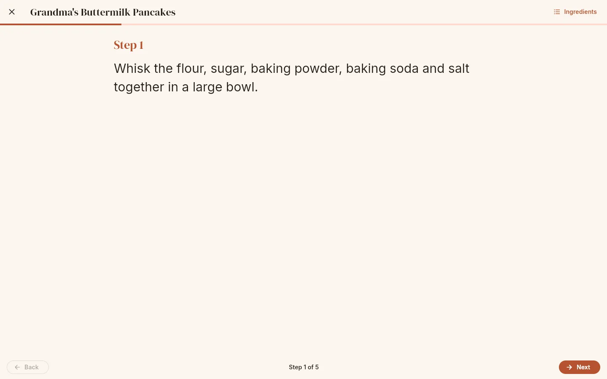
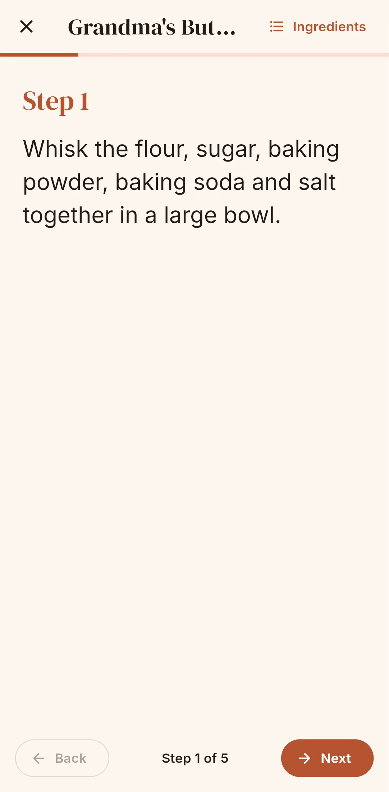

# Cook mode

Cook mode shows one step at a time in large type, so you can follow a recipe from across the
kitchen.

{ .screenshot }

## How to start

Tap **Cook** on a recipe page. Cook mode opens with the servings you had selected on the
recipe page.

While cook mode is open the screen is kept awake (it stops sleeping on Android and, where the
browser supports it, on the web). It goes back to normal when you leave.

## Moving between steps

- Swipe left and right, or use **Back** and **Next** at the bottom. "Step 3 of 5" shows where
  you are, and the progress bar under the title fills as you go.
- On the last step **Next** becomes **Done**, which closes cook mode.
- With a keyboard: **→** next step, **←** previous step, **Esc** exit.
- **×** (top left, "Exit cook mode") goes back to the recipe.

If a step belongs to a section ("FOR THE SAUCE"), the section name is shown above the step
number. A recipe without instructions shows a single "No instructions for this recipe." page.

## Ingredients

**Ingredients** (top right) opens a sheet with the full ingredient list, scaled to the servings
you started with and converted to your **Units** preference. Tap ingredients to tick them off;
the ticks stay while cook mode is open.

## Timers

When a step mentions a duration, cook mode shows a **Start 25:00 timer** button for each one.

{ .screenshot }

- You can run several timers at once. Running timers appear in a strip above the step
  buttons with the time left, the words they came from ("25 minutes"), **Pause** / **Resume** and
  **Cancel timer**.
- Timers keep running if you move to another step.
- When a timer reaches zero, the app shows **Time's up!** with the timer label and recipe name,
  and alerts every 2 seconds (for up to about a minute) until you tap **Dismiss**. On Android
  the alert is the system alert sound plus vibration; on the web it is three short beeps.

!!! warning "Keep the app open"

    Timers live inside the app. They are not system alarms: if Android closes the app or you
    close the browser tab, running timers are lost. Some browsers block sound until you have
    clicked or tapped the page once.

### What counts as a timer

Durations are found in the step text with these rules:

| Text | Timer |
|---|---|
| `25 minutes`, `25 mins`, `25 min`, `5m` | 25:00, 5:00 |
| `1 hour`, `2 hrs`, `1h` | 1:00:00, 2:00:00 |
| `30 seconds`, `45 secs` | 0:30, 0:45 |
| `1 hour 30 minutes`, `1 hour and 30 minutes` | 1:30:00 |
| `1 and a half hours` | 1:30:00 |
| `10-12 minutes`, `10 to 12 minutes`, `2 or 3 minutes` | the **upper** bound: 12:00, 3:00 |
| `1½ hours`, `1 1/2 hours`, `1.5 hours`, `1,5 hours` | 1:30:00 |
| `half an hour` | 30:00 |
| Number words: `a`, `an`, `one`…`twelve`, `fifteen`, `twenty`, `thirty`, `forty`, `forty-five`, `fifty`, `sixty`, `ninety` | `ten minutes` → 10:00 |

A single-letter unit (`m`, `h`) only counts when attached to the number (`5m`, not `5 m`).
Anything shorter than 10 seconds is ignored, so "in a second bowl" does not create a timer.
Ranges, fractions and mixed numbers work as above. The same chips are shown on the recipe page
next to each step.
