# Printable cookbook

Larder turns your recipes into a book-like PDF: a title page, an optional dedication, a table
of contents, a chapter opener for each chapter, one recipe per page with running heads and page
numbers, and an index. It is typeset by an embedded [Typst](https://typst.app) engine, on the
server in connected mode and on the phone in standalone mode.

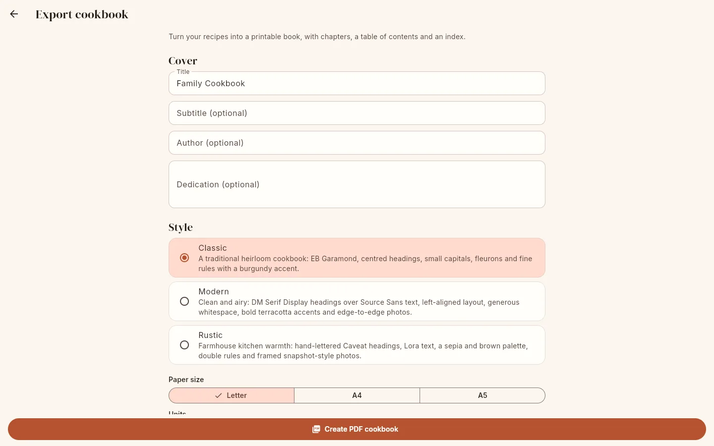{ .screenshot }

Open it from the recipe list (**⋮ → Export cookbook**) or **Settings → Data → Export cookbook
(PDF)**. Fill in the options and tap **Create PDF cookbook**. Large books can take a while
("Generating PDF…").

- **Web**: the PDF is downloaded, named after the title (for example `Family-Cookbook.pdf`).
- **Android**: the PDF is saved in the app's `exports` folder and the share sheet opens so you
  can open it in a PDF viewer, save it to Files or send it to a print shop.

## Sample books

These were generated from the same sample recipes in each theme on Letter paper.

| Theme | Download |
|---|---|
| Classic | [cookbook-classic-letter.pdf](../assets/cookbook/cookbook-classic-letter.pdf) |
| Modern | [cookbook-modern-letter.pdf](../assets/cookbook/cookbook-modern-letter.pdf) |
| Rustic | [cookbook-rustic-letter.pdf](../assets/cookbook/cookbook-rustic-letter.pdf) |

## Options

### Cover

| Option | Notes |
|---|---|
| **Title** | Defaults to "Family Cookbook". Shown on the title page, in the PDF metadata and in the file name. |
| **Subtitle (optional)** | Under the title. |
| **Author (optional)** | At the foot of the title page and in the PDF metadata. |
| **Dedication (optional)** | Gets its own page after the title page. Line breaks are kept. |

### Style

**Theme**: **Classic**, **Modern** or **Rustic** (see [Themes](#themes)).

**Paper size**:

| Paper | Size | Layout |
|---|---|---|
| **Letter** | 8.5 × 11 in | Ingredients and instructions side by side; 3-column index |
| **A4** | 210 × 297 mm | Same as Letter |
| **A5** | 148 × 210 mm | Text 12% smaller; ingredients above instructions; 2-column index |

**Units**: **Original**, **Metric** or **Imperial**. Defaults to your units preference. Recipes
are printed at their original yield. See [Conversion rules](../reference/ingredients.md#conversion);
the PDF rounds metric amounts to kitchen precision (for example `473 ml` becomes `475 ml`).

### Recipes

**All (N)** prints every recipe. **Selected (N)** prints only the ones you pick with **Choose
recipes**: search, tick recipes, **Select shown** ticks every recipe matching the search,
**Clear** unticks all. You must pick at least one.

### Chapters

| Option | Chapters |
|---|---|
| **By category** | One chapter per category. A recipe goes into the chapter of its **first** category. |
| **By tag** | One chapter per tag, using each recipe's **first** tag. |
| **No chapters** | A single chapter called "Recipes", with no chapter numbers. |

Recipes without a category (or tag) go into a final chapter called **Other Recipes**. If none of
the selected recipes has a category (or tag), the book has a single chapter called **Recipes**
instead.
Chapter names are matched without regard to case; an all-lower-case name gets a capital first
letter ("soups" → "Soups").

**Chapter order.** By default, chapters named after
[Larder's categories](organize.md#larders-categories) come first, in meal order (Breakfast,
Appetizers & Snacks, Soups & Stews, Salads, Main Dishes, Side Dishes, Breads, Desserts, Drinks,
Sauces & Condiments, Seasonings & Spice Mixes, Household & DIY); any other chapters follow
alphabetically, and "Other Recipes" comes last.

**Custom chapter order**: turn it on and drag the chapters into the order you want ("Drag to
reorder"). The list shows exactly the chapters the book will have for the current selection
and grouping (each recipe's first category or tag). Chapters you leave out of the order follow
in the default order. Within a chapter, recipes are always alphabetical.

### Include

| Switch | Default | Effect |
|---|---|---|
| **Photos** | on | Recipe photos, downscaled to at most 1400 px on the long edge and re-encoded as JPEG (quality 80) so the PDF stays a reasonable size. |
| **Table of contents** | on | A "Contents" section with chapters and recipes and their page numbers. Long names wrap, with the page number kept in its own column. Two columns for more than 36 recipes (not on A5). |
| **Index** | on | See [The index](#the-index). |
| **Notes** | on | The recipe notes. |
| **Nutrition** | off | A "Nutrition per serving" line. |

Below the options, **Export all as JSON backup** makes a [backup](backup.md) instead.

## Themes

=== "Classic"

    A traditional heirloom cookbook: EB Garamond, centred headings, small capitals, fleurons
    and fine rules with a burgundy accent.

    

    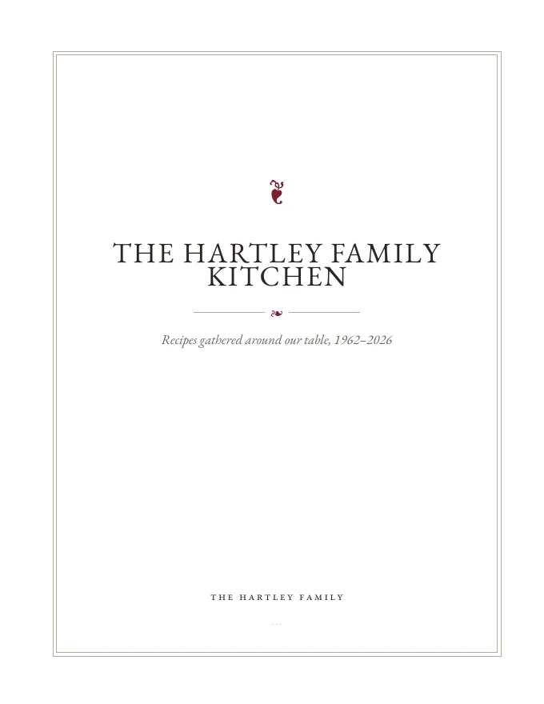{ .screenshot }
    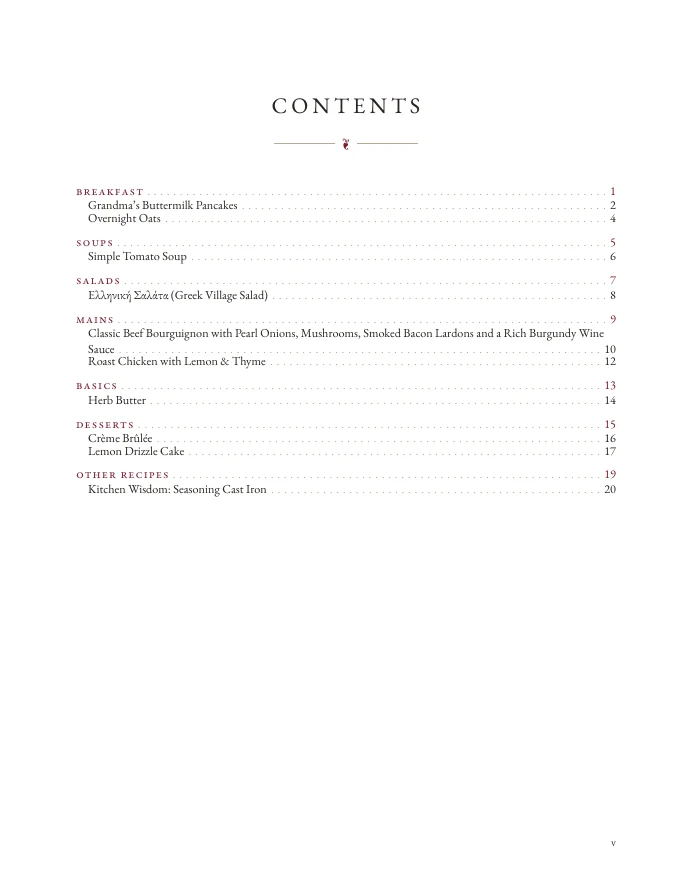{ .screenshot }
    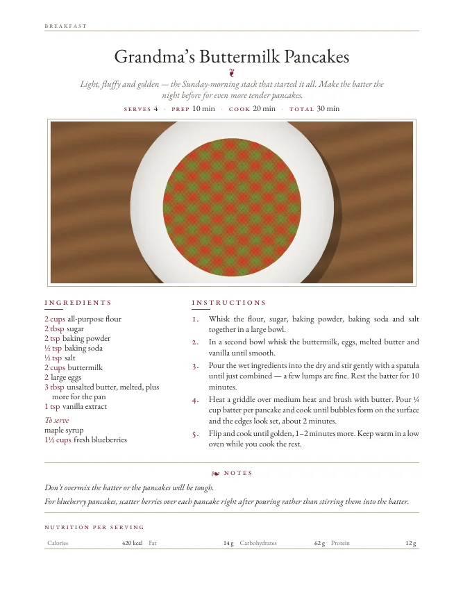{ .screenshot }
    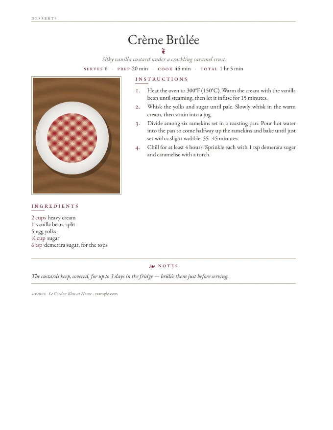{ .screenshot }
    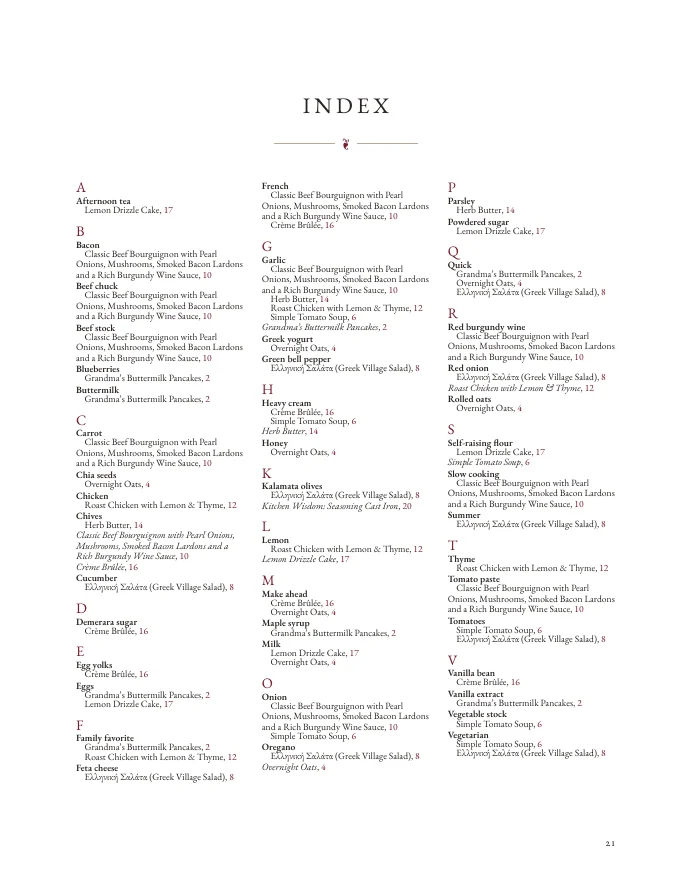{ .screenshot }

    

=== "Modern"

    Clean and airy: DM Serif Display headings over Source Sans text, left-aligned layout,
    generous whitespace, bold terracotta accents and edge-to-edge photos.

    

    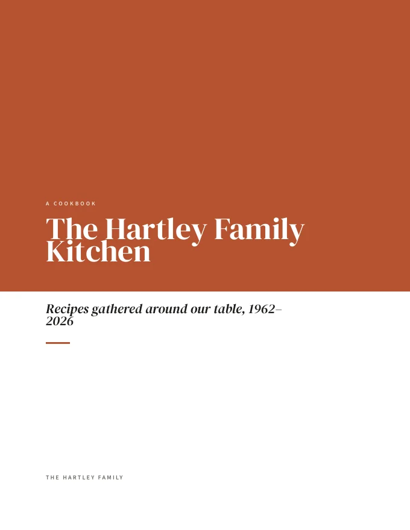{ .screenshot }
    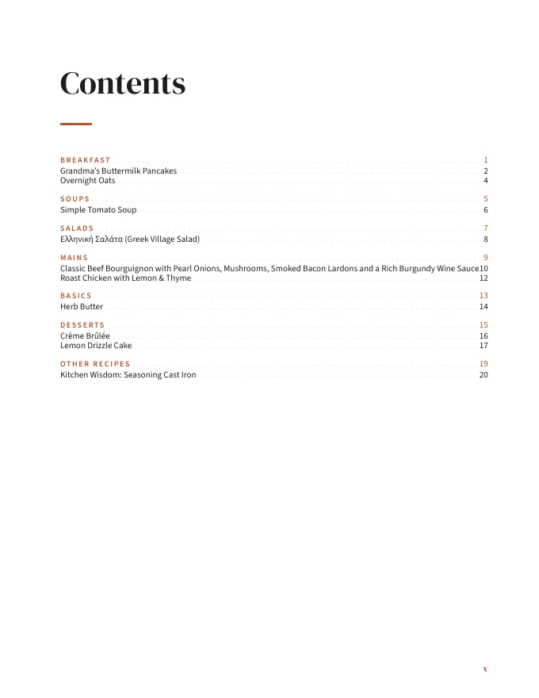{ .screenshot }
    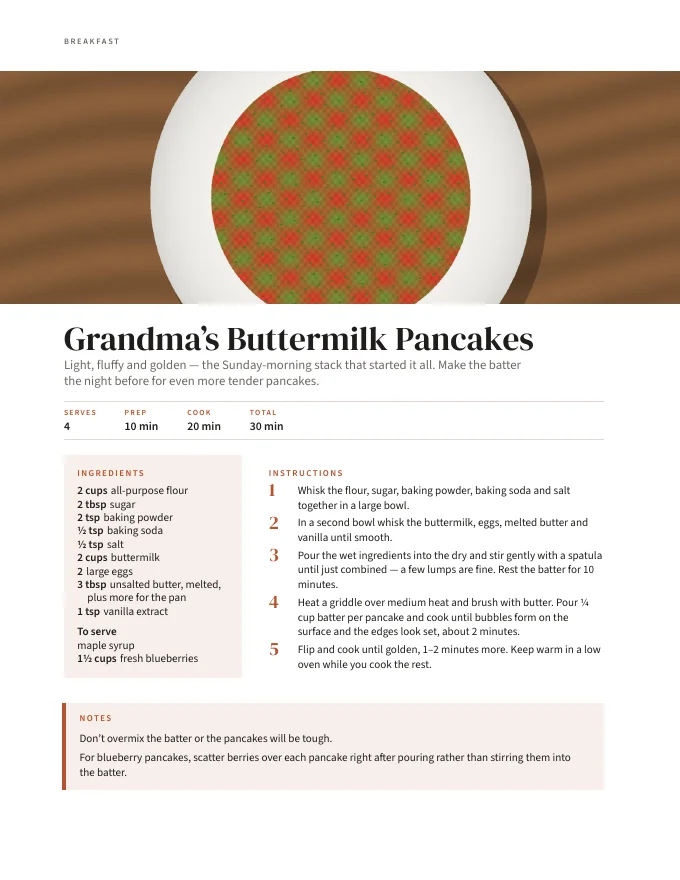{ .screenshot }
    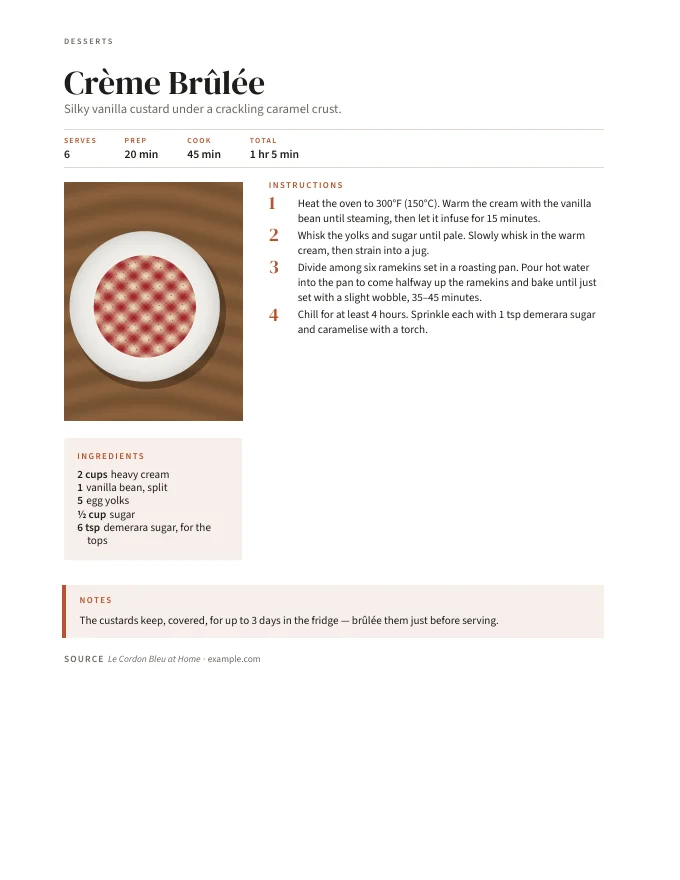{ .screenshot }
    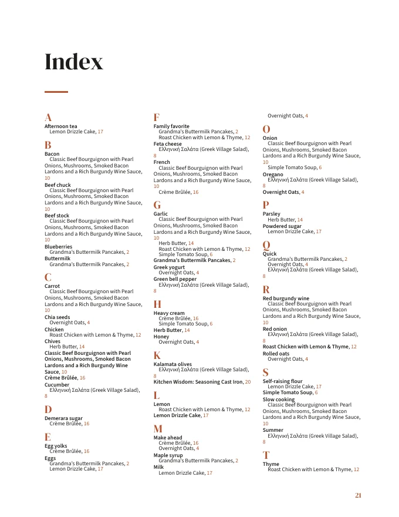{ .screenshot }

    

=== "Rustic"

    Farmhouse kitchen warmth: hand-lettered Caveat headings, Lora text, a sepia and brown
    palette, double rules and framed snapshot-style photos.

    

    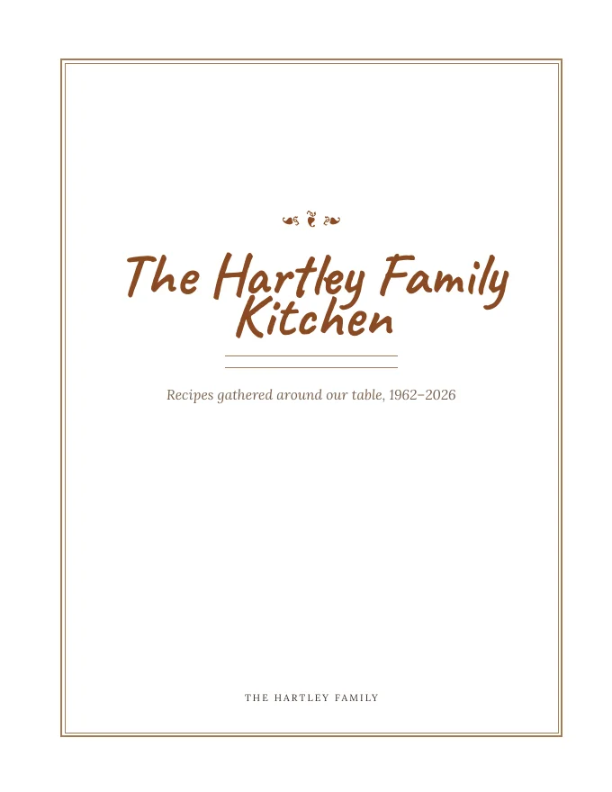{ .screenshot }
    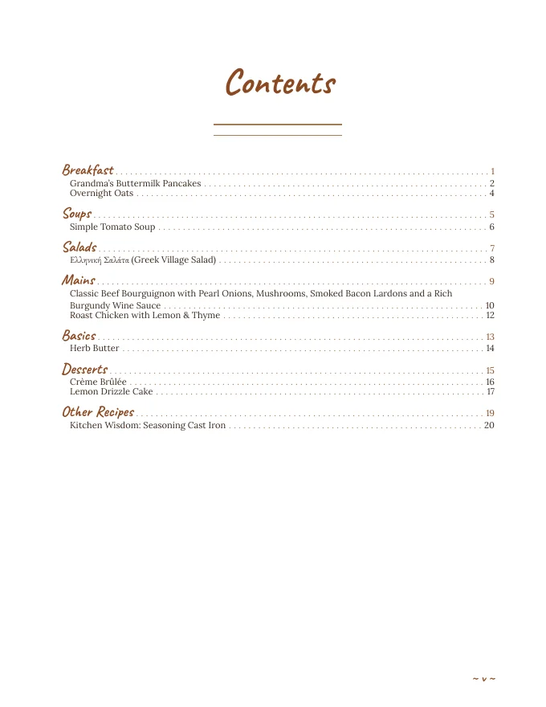{ .screenshot }
    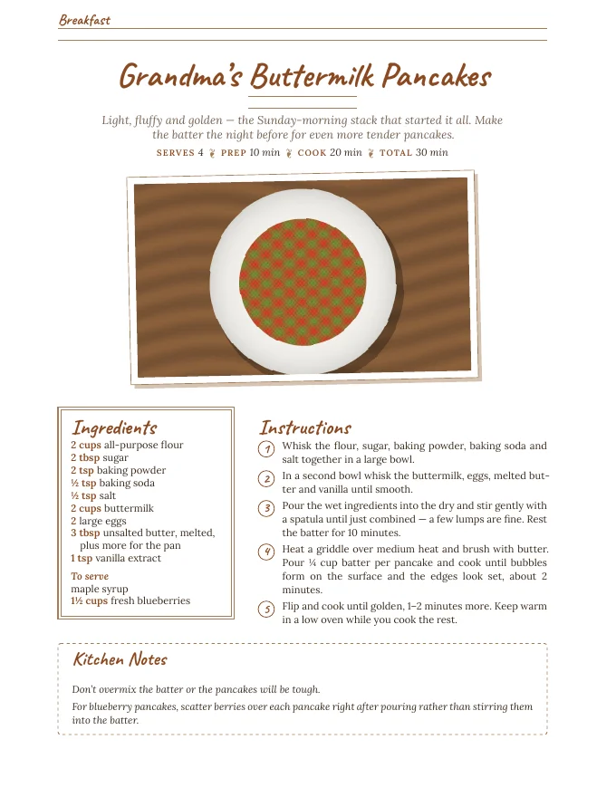{ .screenshot }
    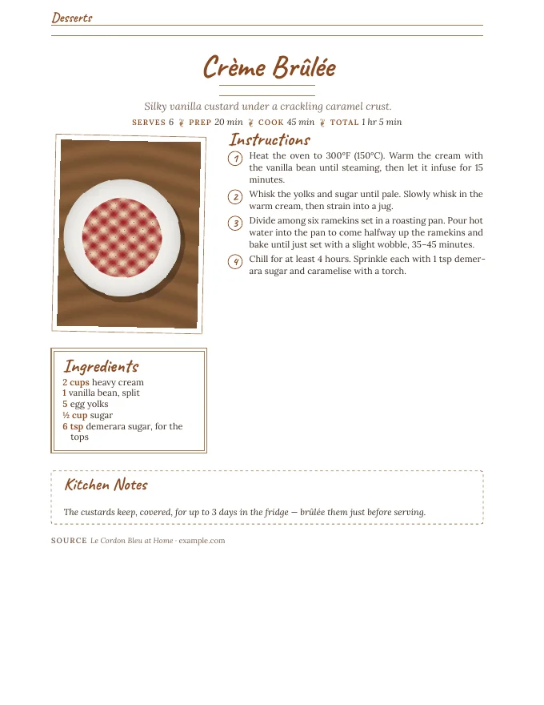{ .screenshot }
    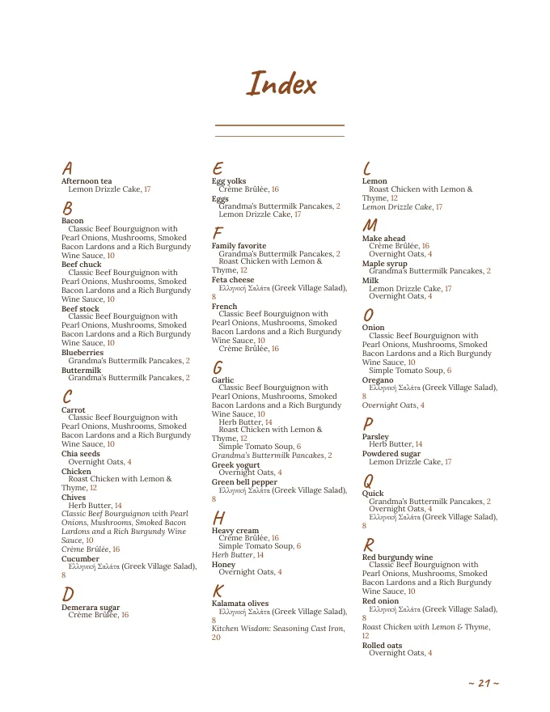{ .screenshot }

    

## What a recipe page contains

Each recipe starts on a new page and may run onto following pages. In order: the name; the
description; a line with **Serves** (or **Makes** for other yield units, such as "Makes 24
cookies"), **Prep**, **Cook** and **Total**; the photo; **Ingredients** (with section
headings, amounts set apart from the item) and **Instructions** (numbered, with section
headings); notes; nutrition; and the **Source** (name and website, linked).

Landscape photos are printed as a banner across the page. Portrait photos sit in the
ingredients column when ingredients and instructions are side by side. Quotes are turned into
typographic quotes and fractions into fraction characters (½).

## The index

The index lists, alphabetically under letter headings:

- **Every recipe** by name, with its page number.
- **Ingredient headwords** with the recipes that use them: up to 8 per recipe, taken from the
  parsed food name with leading descriptors removed ("large eggs" → "eggs", "freshly chopped
  parsley" → "parsley"). Headwords of 1 or more than 32 characters, more than four words, or
  containing digits are skipped, as are staples such as salt, pepper, water, oil, olive oil,
  sugar, flour, butter, baking soda and baking powder.
- **Tags** as headwords with their recipes.
- Singular and plural headwords are merged ("egg" into "eggs").
- A headword that would only point to a recipe of the same name is left out.

Entries starting with a digit or symbol are grouped under `#`, before A.

## Printing and binding

The PDF is laid out as a two-sided book:

- Margins are mirrored: the **inside** margin (towards the binding) is wider than the outside
  one. Page numbers and running heads sit on the outer edge.
- The title page is page 1 (a right-hand page). The dedication, the contents, **every chapter
  opener** and the index always **start on a right-hand (odd) page**; a blank page is inserted
  before them when needed. Blank pages have no header or page number.
- Front matter (contents) is numbered with roman numerals; numbering restarts at 1 with the
  first chapter.

Tips:

- Print **double-sided, flipping on the long edge** ("duplex, long-edge binding"), at **100% /
  actual size**, not "fit to page", so the mirrored margins line up.
- Choose the matching paper. A5 books can be printed two-up on A4 with a booklet setting.
- For ring or comb binding, the inside margin (0.95 in on Letter, 24 mm on A4, 17 mm on A5)
  leaves room for the holes.
- Print shops usually want the page count to be a multiple of 4; add blank pages at the end if
  asked.
- Photos are embedded at up to 1400 px on the long edge, plenty for the photo sizes used on
  the page (a full-width banner on Letter is under 7 inches wide, about 200 dpi).

## Fonts and languages

The themes use bundled fonts (EB Garamond, DM Serif Display, Source Sans 3, Caveat, Lora),
falling back to Typst's built-in Libertinus Serif, New Computer Modern and DejaVu Sans Mono.
These cover Latin, Greek and Cyrillic.

!!! warning "Chinese, Japanese, Korean, Arabic, Devanagari and other scripts"

    Text in scripts the bundled fonts do not cover is printed as missing glyphs (empty boxes),
    and the layout is designed for left-to-right text (the document language is set to
    English), so right-to-left scripts may not lay out correctly. On a server you can add fonts:
    set `LARDER_COOKBOOK_FONT_DIRS` to a `:`-separated list of directories containing `.ttf`,
    `.otf`, `.ttc` or `.otc` files (for example Noto Sans CJK). They are scanned once, not
    recursively, when the first cookbook is rendered, and used as fallbacks. This cannot be
    set in the Android app's standalone mode. Hyphenation rules are always English.

## Limits

A single cookbook can contain at most 5000 recipes. An empty selection gives a book with a
single page saying "No recipes yet — this cookbook is waiting to be filled."
