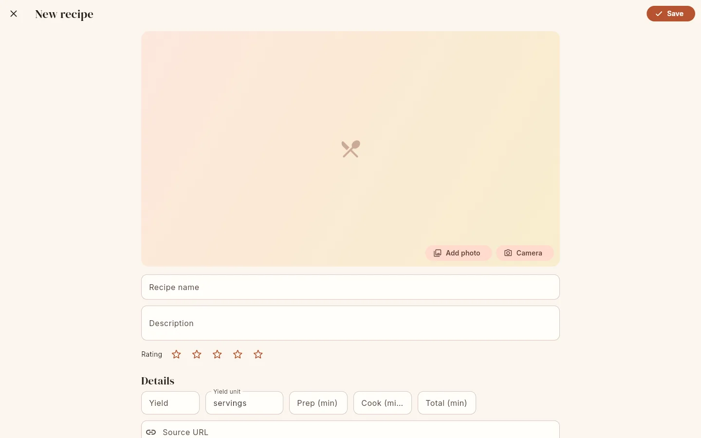
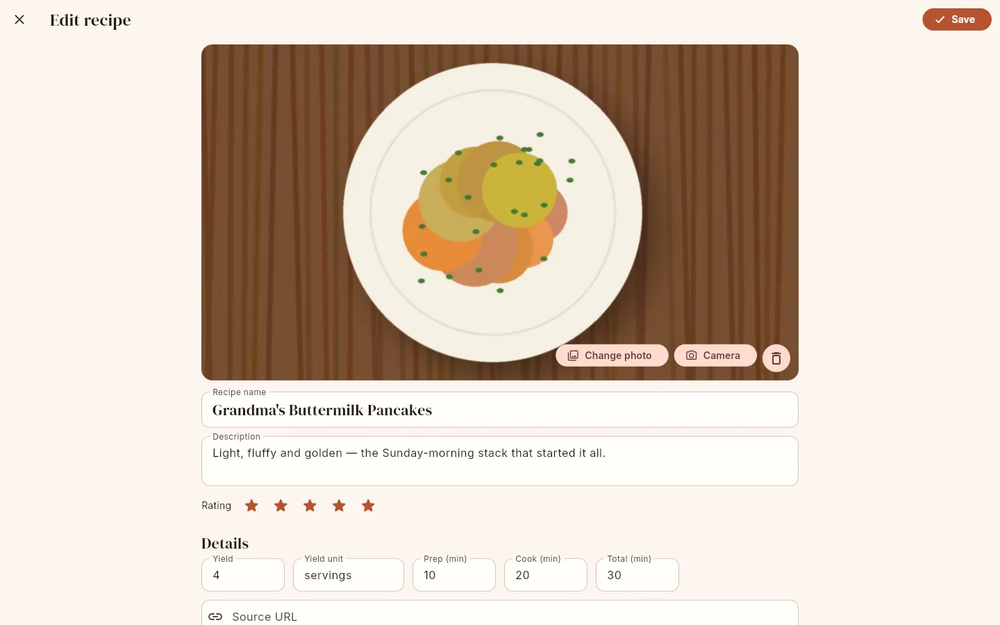

# Editing recipes

Open the editor with **Add recipe** › **Write it myself** on the recipe list, the **✎** button on a recipe page, or
**Preview & edit** on the Import screen (which opens the editor prefilled with the imported,
unsaved recipe).

{ .screenshot }

{ .screenshot }

The title bar says **New recipe** or **Edit recipe**. **Save** (top right) saves and opens the
recipe. **×** closes the editor; if you changed anything you are asked **Discard changes?**.
The Android back gesture asks the same question.

## Photo

| Button | What it does |
|---|---|
| **Add photo** / **Change photo** | Pick an image (gallery on Android, file chooser on the web) |
| **Camera** | Take a picture (Android); on the web this depends on the browser |
| **🗑 Remove photo** | Removes the photo when you save |

Pictures are downscaled to at most 2400 × 2400 px on the device before upload. The server (or
the on-device engine) accepts JPEG, PNG, WebP and GIF, stores them as JPEG in three sizes
(320, 960 and 2400 px on the longest edge) and rejects images over 80 megapixels.

!!! note "Photos need a connection"

    In connected mode the recipe text is saved offline if necessary, but the photo is uploaded
    directly. If you save while offline you are told "Saved offline. Add the photo again once
    you are online."

## Fields

| Field | Notes |
|---|---|
| **Recipe name** | Required ("Give your recipe a name"). At most 300 characters. Extra spaces are collapsed. |
| **Description** | Free text. |
| **Rating** | 0 to 5 stars. Tap a star to set it. |
| **Yield** | A number: `4`, `1.5`, `1 1/2` and `1½` are all accepted. Used for [scaling](scaling.md). Zero or negative is treated as empty. |
| **Yield unit** | Defaults to "servings". Anything else ("cookies", "loaf") is shown as "Makes 24 cookies". |
| **Prep (min)**, **Cook (min)**, **Total (min)** | Whole minutes. If **Total** is empty it is calculated as prep + cook when you save. |
| **Source URL** | A link to where the recipe came from. |
| **Source name** | For example "Grandma" or "NYT Cooking". |
| **Category** | Chips. Type in **Add category** and press Enter or type a comma, or pick a suggestion; tap a chip's **×** to remove it. Categories become the chapters of the [printable cookbook](cookbook.md). |
| **Tag** | Chips, in **Add tag**, as above. Suggestions come from your recipes and, when connected, the server. |
| **Ingredients** | One line per ingredient; see below. |
| **Instructions** | One step per line; see below. |
| **Notes** | "Tips, substitutions, storage…" |
| **Nutrition** | Pairs of name and value, for example `calories` → `250 kcal`. **Add** adds a row; **⊖** removes one. Rows with an empty name or value are dropped. |

Tags and categories are de-duplicated case-insensitively ("Quick" and "quick" become one),
and entries longer than 80 characters are dropped.

## Ingredients

"One ingredient per line, e.g. "1 ½ cups flour, sifted". Start a line with ## for a section
heading."

- **Add ingredient** adds an empty line; pressing Enter in a line also adds one below it.
- **Add section** adds a line starting with `## `. Type a heading such as `For the sauce`.
  Every ingredient below it, up to the next heading, belongs to that section.
- Drag the **⠿** handle to reorder lines. **⊖** removes a line.
- **Bulk edit** opens all lines as one text box, handy for pasting a whole list.

Each line is parsed into quantity, unit, food and note (for example `1 1/2 cups sugar,
divided` → 1.5 · cup · sugar · divided). Lines you did not change keep their existing parse.
The rules are described in [Ingredient parsing & units](../reference/ingredients.md).

### How Larder tidies ingredient lines

When you save (and whenever a recipe is imported), every ingredient line that Larder
understands is rewritten in one standard form, so all your recipes spell units and foods the
same way:

| You type | Saved as |
|---|---|
| `2 Tablespoons butter, melted` | `2 tbsp butter, melted` |
| `3 large Eggs, beaten` | `3 eggs, large, beaten` |
| `1 cup finely chopped fresh cilantro` | `1 cup cilantro, fresh, finely chopped` |
| `1 1/2 cups All Purpose Flour` | `1 1/2 cups all-purpose flour` |
| `10 ounce can crushed pineapple` | `1 can pineapple, crushed, 10 oz` |
| `2 Tomatoe` | `2 tomato` |

What happens:

- Units are written in their standard short form (`tbsp`, `oz`, `cups`).
- Preparation, temperature and size words (chopped, melted, softened, large, fresh, …) move
  from the food name into the note; size words and "fresh" come first.
- Common misspellings are corrected ("tomatoe", "parmesean", "brocolli"), and different names
  for the same thing are unified ("confectioners' sugar" → "powdered sugar", "scallions" →
  "green onions", "egg" → "eggs").
- Food names are lower case, except proper names ("Parmesan", "Dijon", "Old Bay") and
  acronyms ("BBQ").

Lines Larder cannot read reliably are **kept exactly as you wrote them**: lines without a
quantity whose food contains a number ("Juice of 2 lemons"), sub-recipes and instructions
written as one line ("egg wash: 1 egg beaten with milk"), and lines with an unknown unit.
The full lists are in
[Ingredient parsing & units → Normalisation](../reference/ingredients.md#normalisation).
Recipes saved before this tidying existed can be updated in bulk with
[Organizing recipes](organize.md).

## Instructions

Each line (it can wrap over several lines in the text box) is one step and gets a number.
Lines starting with `#` are section headings and are not numbered. **Add step**, **Add
section**, drag handles, **⊖** and **Bulk edit** work as for ingredients. In **Bulk edit**,
every non-empty line becomes one step.

Durations in steps ("simmer for 20 minutes") are detected automatically for
[cook mode timers](cook-mode.md#timers); you do not need to mark them.

## Saving and conflicts

In connected mode the recipe is saved on your device immediately and sent to the server. If
you are offline it is queued: "Saved offline. It will sync when you are back online."

Each recipe has a version number. If someone else saved the same recipe after you opened it,
the server refuses your save and you see **Recipe changed elsewhere**:

**Reload**
:   Discards your edits and loads their version into the editor.

**Overwrite with mine**
:   Saves your version anyway, replacing theirs.

If the conflict is discovered later, while sending changes you made offline, the server's
version is kept and you get a notice: "Saving "*name*" was changed by someone else; the server
version was kept." See [Offline use & sync](offline.md).

## Rename, delete, duplicate

Renaming a recipe gives it a new [slug](recipes.md#recipe-addresses). Deleting and duplicating
are on the recipe page's **⋮** menu.

## Bulk-renaming tags and categories

The app has no screen for this, but the API does: `POST /api/tags/rename` renames (and merges)
a tag or category across all recipes, and `POST /api/tags/delete` removes one. See the
[HTTP API](../reference/api.md#recipes).
