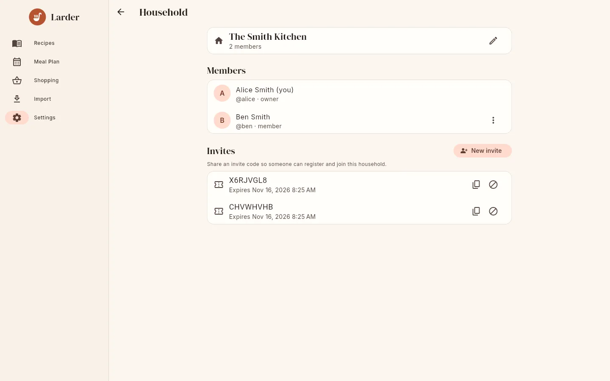

# Households & sharing

On a Larder server every user belongs to exactly one **household**. Everything in a household
is shared by all its members:

| Shared with the household | Personal |
|---|---|
| Recipes (every member can edit and delete them) | Favourites |
| Meal plan | Units preference |
| Shopping lists | Password, display name, email |
| Import history | Theme (device setting) |

There is no sharing between households.

## Roles

| Role | Can |
|---|---|
| **Member** | Everything with recipes, meal plans, shopping lists and imports. See the member list. |
| **Owner** | Everything a member can, plus rename the household, create and revoke invites, change members' roles and remove members. A household can have several owners and always has at least one. |
| **Server admin** | A separate, server-wide flag, shown as the **Server admin** badge. Manages all accounts under **Settings → Server users**. See [Users & administration](../admin/users.md). |

Your role is shown on your Settings card: **Household owner** or **Member**.

## The Household screen

**Settings → Household** shows the household name and member count, the members (with
"(you)" next to your name, `@username` and role) and, for owners, the invites.

{ .screenshot }

### How to rename the household (owners)

Tap the **✎** ("Rename") next to the name, enter a new **Household name** (1–100 characters)
and **Save**.

### How to invite someone (owners)

1. Tap **New invite**.
2. Choose **Invite expires in**: **1 day**, **7 days** or **30 days**.
3. The code is copied: "Invite code X6RJVGL8 copied to clipboard".

Active invites are listed with their expiry time, a **Copy** button and a **Revoke** button.
Expired invites disappear from the list. A code works for any number of people until it
expires or is revoked. Codes are not case-sensitive.

The person registers on your server with the code; see
[First steps](../getting-started/first-steps.md#2-invite-your-family). Someone who already has
an account on the server cannot use an invite to switch households.

### How to change a member's role (owners)

Open the **⋮** menu next to the member and choose **Make owner** or **Make member**. You cannot
demote yourself if you are the only owner ("a household needs at least one owner"); this is
only possible through the API, since the app does not show the menu for yourself.

### How to remove a member (owners)

**⋮ → Remove from household**, then confirm. The person is not deleted: "They will be moved to
a new household of their own", called "*Name*'s Kitchen", as its owner, and keeps their
account. They lose access to your recipes, plan and lists. You cannot remove yourself.

## Leaving a household

There is no **Leave** button. Ask an owner to remove you; you then get your own empty
household. If you want to take recipes with you, export a [backup](backup.md) first and
import it afterwards.

## Open registration

If the administrator sets `LARDER_ALLOW_REGISTRATION=true`, anyone who can reach the server
can create an account without an invite code. Each such account gets its own new household as
owner. People with an invite code still join the inviter's household.
