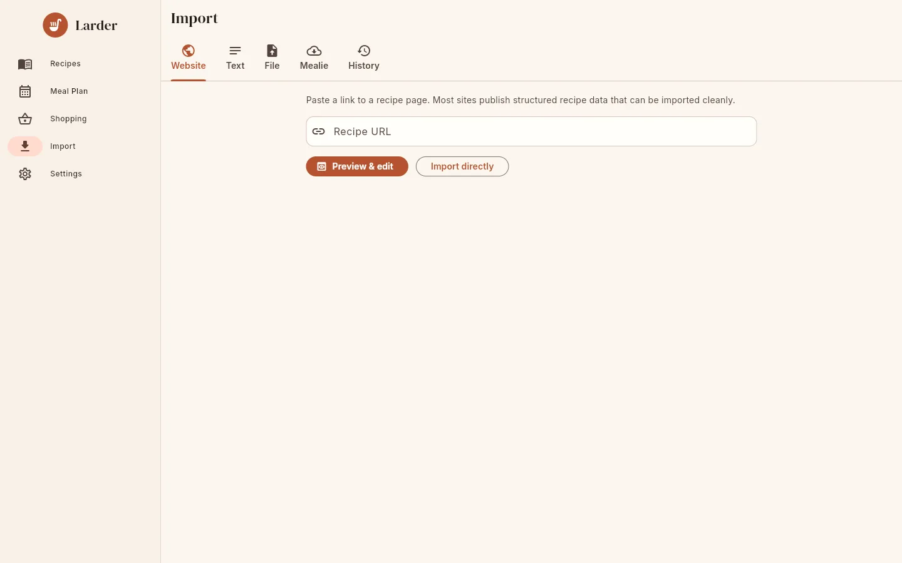

# Importing recipes

The **Import** screen has a tab for each way of bringing recipes in. On a phone, open it with
the import button at the top of **Recipes** or **Trial**; on a wider screen it also has its own
entry in the side rail.

{ .screenshot }

| Tab | For |
|---|---|
| **Website** | One recipe from a web page |
| **Text** | One recipe pasted as text |
| **Photo** | One recipe from a photo (only shown when [AI assist](ai.md) is available) |
| **File** | A whole collection from an export file |
| **Mealie** | A whole collection straight from a running Mealie server |
| **History** | Past bulk imports |

In connected mode imports run **on the server**, so they need a connection ("Importing needs a
connection to the server."). In standalone mode they run on the phone.

## Websites

1. Copy the address of a recipe page.
2. Paste it into **Recipe URL**.
3. Choose:
    - **Preview & edit**: opens the editor with the imported recipe so you can check and fix it
      before tapping **Save**. Nothing is stored until you save.
    - **Import directly**: saves it immediately and opens it.

Larder reads the recipe data most recipe sites publish for search engines (schema.org
`Recipe` in JSON-LD, or microdata). If a page has several recipes, the most complete one is
used. It also picks up the page title, description and site name from the page's metadata
when the recipe itself does not have them, and the photo (from the recipe or the page's
`og:image`). The source URL is the final address after redirects.

If a page has no recipe markup you get "no recipe found". Copy the text and use the **Text**
tab instead.

!!! info "Limits"

    Only `http://` and `https://` addresses can be imported. Pages are fetched with a 20-second
    timeout and may be at most 10 MB; photos at most 20 MB. On the server, addresses that
    point at the server itself (`localhost`, loopback), link-local addresses (such as cloud
    metadata endpoints) or unspecified addresses are refused with "this address cannot be
    imported from"; this is checked for every DNS lookup and every redirect, and for photos the
    page links to. Addresses on your local network are allowed. See
    [Security](../admin/security.md#importing-from-urls).

## Text

Paste a recipe into the box and tap **Preview & edit**. The parser works best with headings:

```text
Grandma's Apple Pie

Serves 8
Prep time: 30 min
Bake time: 1 hour

Ingredients
For the crust:
2 1/2 cups flour
1 cup cold butter, diced

Instructions
1. Rub the butter into the flour.
2. Add water until it comes together.

Notes
Freezes well.
```

- The first non-empty line is the title ("Title:" and leading `#` are removed).
- Headings it recognises (with or without `#`, `:` or bold markers) include **Ingredients**,
  "What you need", "You will need", "Shopping list"; **Instructions**, "Directions", "Method",
  "Preparation", "Steps", "How to make", "Procedure"; and **Notes**, "Tips", "Cook's notes".
  German, French, Spanish, Italian and Dutch headings such as "Zutaten" and "Zubereitung" work
  too.
- Before the instructions, lines such as "Serves 4", "Makes 12 cookies", "Prep time: 10 min",
  "Cook time", "Total time", "Ready in", "Source", "Category", "Tags" and "Cuisine" fill in the
  matching fields. Several can share a line: `Prep: 10 min | Cook: 20 min`.
- Inside the ingredients, a line ending in `:` or starting with `#` is a section heading.
- Numbered steps (`1.`, `2)`, `Step 3:`) start new steps and unnumbered lines continue them;
  without numbering every line is a step.
- Without any headings, lines that look like ingredients (they start with a quantity, or a
  `-`, `*` or `•` bullet) become ingredients and the rest become steps.

When AI assist is available, the **Use AI to structure the recipe** switch ("Better results
for messy text") sends the text to the AI provider instead. See [AI assist](ai.md).

If no title can be found you get "could not find a recipe title in the text". Text is limited
to 200,000 characters.

## Photos

Only shown when [AI assist](ai.md) is enabled (by the server admin, or in standalone mode by
you in Settings).

1. Tap **Take photo** or **Choose image** ("Take a photo of a recipe card or cookbook page.").
2. The AI transcribes it; the editor opens with the result.
3. Check it and tap **Save**.

The photo is downscaled (at most 2400 px on the device, then 2000 px on the server) and sent
to the AI provider. In standalone mode the photo also becomes the recipe's picture when you
save. In connected mode the preview does not keep the photo; use **Add photo** in the editor
if you want it as the recipe picture. (The API's `POST /api/import/image` with `save=true`
does keep it.)

## Files

1. Export your recipes from the other app (see below).
2. On the **File** tab, leave **Source** on **Detect automatically** or pick the format.
3. Leave **Skip recipes I already have** on (see [Duplicates](#duplicates)).
4. Leave **Sort recipes into categories** on to give uncategorised recipes a category (see
   [Categories on import](#categories-on-import)).
5. Tap **Choose file & import** and pick the file.

A progress card appears at the top: "35 of 120 processed · 34 imported · 1 skipped". You can
leave the screen; on the server the import continues in the background and appears under
**History**. When it finishes you see "Import finished: N recipes imported".

The **Source** options:

| Option | File |
|---|---|
| **Detect automatically** | Works for all of the below |
| **Mealie export / backup (.zip)** | Mealie recipe export zip or full backup zip |
| **Tandoor export (.zip)** | Tandoor export |
| **Paprika (.paprikarecipes)** | Paprika export (also a single `.paprikarecipe`) |
| **Nextcloud Cookbook (.zip)** | A zip of the Nextcloud Cookbook folder |
| **Recipe Keeper (.zip)** | Recipe Keeper export zip |
| **Larder backup (.zip)** | A Larder backup |
| **schema.org JSON-LD (.json)** | A `.json` file with one recipe or a list |

The [Import formats reference](../reference/import-formats.md) lists which fields are imported
from each format.

### Mealie (export or backup zip)

=== "Recipe export"

    In Mealie, go to **Settings → Data management → Export** (the exact menu depends on your
    Mealie version) and export your recipes. You get a zip with one folder per recipe
    (`recipes/<slug>/<slug>.json` and `images/original.webp`).

=== "Backup"

    In Mealie's admin settings, create a **Backup** and download it. A backup zip contains
    `database.json` and `data/recipes/<id>/images/`. Backups carry the most information:
    favourites, per-user ratings, notes and nutrition.

Import the zip with **Source: Mealie export / backup**, or **Detect automatically**.

### Tandoor

In Tandoor, use **Export**, choose the **Default** format and download the zip. It contains
one zip per recipe (each with `recipe.json` and an image). A single recipe zip also works.

### Paprika

In Paprika, choose **File → Export**, select the recipes, and pick **Paprika Recipe Format**.
You get a `.paprikarecipes` file. Photos, categories, ratings and favourites come across.

### Nextcloud Cookbook

In the Nextcloud **Files** app, open your recipes folder (by default **Recipes**), select it
and choose **Download**; Nextcloud gives you a zip. Each recipe folder holds `recipe.json` and
`full.jpg`. Any zip of schema.org JSON files is handled the same way.

### Recipe Keeper

In Recipe Keeper, go to **Settings → Export** and export your recipes as a zip. The zip
contains `recipes.html` and an `images/` folder. Other apps' HTML exports are not supported.

### schema.org JSON-LD

A `.json` file containing one schema.org `Recipe`, a list of them, or a JSON-LD document with
an `@graph`. If the objects have no `@type` but have `name` and `recipeIngredient` or
`recipeInstructions`, they are treated as recipes. An `.html` file saved from a recipe website
also works with **Detect automatically**.

### Larder backups

Use **Source: Larder backup** (or automatic detection) with a zip made by **Export all as JSON
backup**. Favourites and creation dates are kept. See [Backup & restore](backup.md).

## Mealie (live server)

Copy every recipe, with photos, straight from a running Mealie server (v1 or later).

1. In Mealie, open your **user profile** and go to **API Tokens** ("Create an API token in
   Mealie under User Profile → API Tokens"). If you do not see it, your Mealie version may
   require enabling advanced settings for your user first. Give the token a name, create it and
   copy it.
2. On Larder's **Mealie** tab enter the **Mealie URL** (for example
   `https://mealie.example.com`; addresses copied from the browser ending in `/g/home` or
   `/api` are fine) and paste the **API token**.
3. Leave **Skip recipes I already have** and **Sort recipes into categories** on and tap
   **Start import**.

Larder first lists all recipes. A wrong token fails immediately with "unauthorized: the server
rejected the API token". Then each recipe and its image is fetched one by one, with progress
shown as for file imports. You can delete the token in Mealie afterwards.

!!! note "Where the connection comes from"

    In connected mode the **Larder server** connects to Mealie, so the Mealie URL must be
    reachable from the server. The server refuses `localhost` and loopback addresses for
    security: if Mealie runs on the same machine, use the machine's LAN address (for example
    `http://192.168.1.10:9000`) or, in Docker Compose, the Mealie service name. In standalone
    mode the phone connects.

## Duplicates

With **Skip recipes I already have** on (the default), a recipe is skipped if your household
(or, in standalone mode, your phone) already has a recipe with:

- the same **source URL**, or
- the same **name**, ignoring case and accents ("Crème Brûlée" = "creme brulee").

The rule is the same on the server, in standalone mode, and when
[connecting a phone to a server](standalone.md#connecting-to-a-server-later).

Recipes imported earlier in the same file count too, so duplicates inside one export are
skipped as well. Skipped recipes are counted under "skipped". Turn the switch off to import
everything; recipes with the same name then get distinct addresses (`pancakes`, `pancakes-2`).

The **Website** and **Text** tabs never check for duplicates.

## Categories on import

Imported recipes that have **no category** are given the one Larder suggests from their name
(see [Organizing recipes](organize.md#how-a-category-is-chosen)); recipes that already have
categories keep them.

- **Website**, **Text** and **Photo** imports always get the suggestion; you can change it in
  the editor before saving.
- **File** and **Mealie** imports have the switch **Sort recipes into categories** (on by
  default). Turn it off to import recipes exactly as the other app had them.

Every imported recipe's ingredient lines are also
[tidied](editing.md#how-larder-tidies-ingredient-lines), as when you save a recipe yourself.

## Import history

The **History** tab lists the 50 most recent bulk imports for your household (on the server)
or this device (standalone), newest first. Each card shows the source, time, status (a check
mark when done, an error icon when failed, progress while running) and "*processed* of
*total* processed · *imported* imported · *skipped* skipped · *failed* failed". Expand
**N problems** to read up to 50 error messages such as `Recipe 'X': recipe name is required`.

A recipe that cannot be read (no name, broken JSON) is counted as **failed** and listed under
problems; the rest of the file still imports. A file that cannot be read at all marks the job
**failed**.

!!! warning "Server restarts"

    Background imports do not survive a server restart. Jobs that were still running are marked
    failed with "The server restarted before the import finished". Recipes imported before the
    restart are kept; run the import again with **Skip recipes I already have** on to finish.

## Size and safety limits

| Limit | Value |
|---|---|
| Upload size (server) | `LARDER_MAX_UPLOAD_MB`, default 200 MB |
| Non-zip files | 100 MB |
| One file inside a zip, after decompression | 100 MB |
| Everything decompressed from one upload, including nested zips | 1 GB |
| Entries considered per zip | 50,000 |
| Errors kept per job | 200 |

Zip entries with absolute paths or `..` are ignored, as are `__MACOSX/`, `._*`, `.DS_Store`
and `Thumbs.db`. Embedded files that are not recognisable images (JPEG, PNG, WebP, GIF, AVIF,
HEIC, BMP) are dropped; images the server cannot decode (it accepts JPEG, PNG, WebP and GIF)
are left out and the recipe is imported without a photo.
