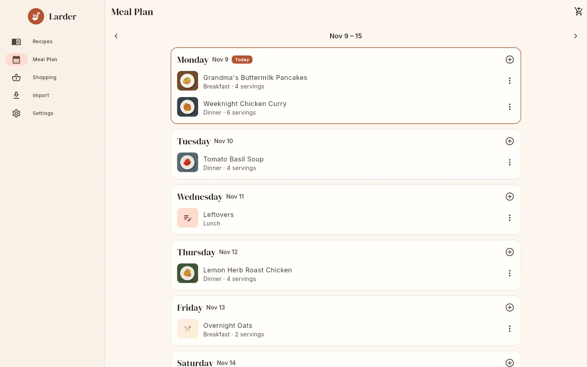
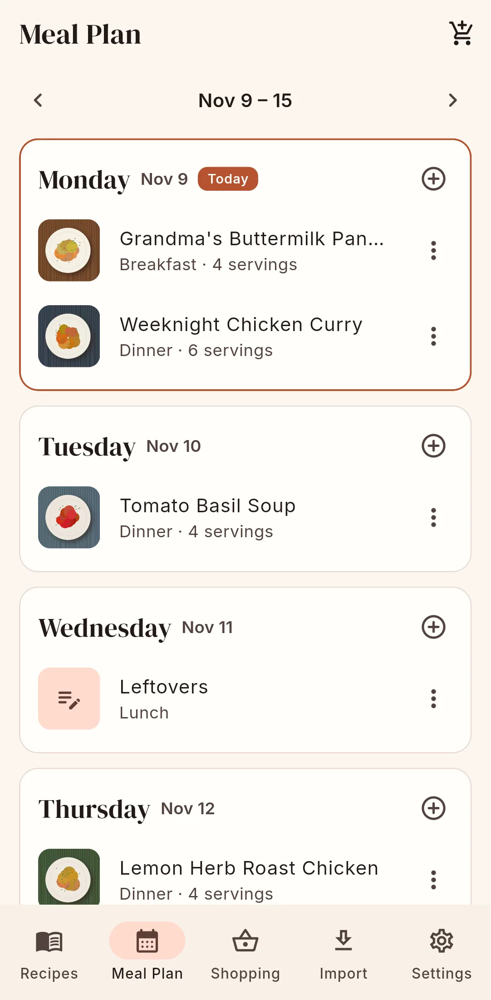

# Meal planner

The **Meal Plan** screen shows one week at a time, Monday to Sunday, with a card for each day.
Today's card is outlined and marked **Today**.

{ .screenshot }

Each household has one shared plan. Every member sees and edits the same entries.

## Moving between weeks

- Swipe left or right, or use the **‹** and **›** buttons ("Previous week", "Next week") around
  the date range ("Nov 9 – 15").
- **Today** appears when you are not on the current week and jumps back to it.
- Pull down to reload the week from the server.

In connected mode the app keeps entries from 30 days ago to 60 days ahead on the device. Weeks
outside that window are loaded from the server when you open them, so they need a connection.

## How to plan a meal

Tap **⊕** ("Add meal") on a day. The **Plan a meal** sheet has:

| Field | Notes |
|---|---|
| Date | Prefilled with the day you tapped. Tap it to choose another date. |
| Meal | **Breakfast**, **Lunch**, **Dinner** (default) or **Snack**. |
| **Recipe** / **Free text** | Plan a recipe, or write something like "Leftovers" or "Eating out". |
| **Search recipes** | (Recipe) Search your recipes and tap one to select it. Shows up to 30 matches. |
| **What are you having?** | (Free text) Required for free-text entries. |
| **Servings** | Prefilled with the recipe's yield when you pick a recipe. Used when you add the plan to a shopping list. |
| **Note** | Optional. |

Tap **Add to plan**. If you forget to pick a recipe you are told "Pick a recipe or switch to a
free-text entry".

You can also plan from a recipe: **⋮ → Add to meal plan** on the recipe page. That dialog asks
for the date (from one year ago to two years ahead), meal and servings.

Within a day, entries are ordered breakfast, lunch, dinner, snack, then by name.

## How to change or remove an entry

- Tap a recipe entry to open the recipe. Tap a free-text entry to edit it.
- The **⋮** menu on an entry has **Edit / move** (change date, meal, recipe, servings or note;
  **Save**) and **Remove**.

{ .screenshot }

## How to shop for the week

Tap the cart button in the top bar ("Add week to shopping list"), then pick a list or create
one with **New list…**. Every **recipe** entry from Monday to Sunday of the week you are looking
at is added to the list:

- Each recipe is scaled to the entry's **Servings** (if the entry has servings and the recipe
  has a yield; otherwise the recipe's own amounts are used).
- The same recipe planned twice is added twice.
- Free-text entries are ignored.
- Ingredients are merged with what is already on the list. See
  [Shopping lists](shopping.md#how-ingredients-are-merged).

When it is done you see "This week's ingredients were added to your list".

## Deleting a recipe that is planned

If you delete a recipe, its meal plan entries keep their date and meal but lose the recipe
link and show as "Untitled". Remove or edit them.
