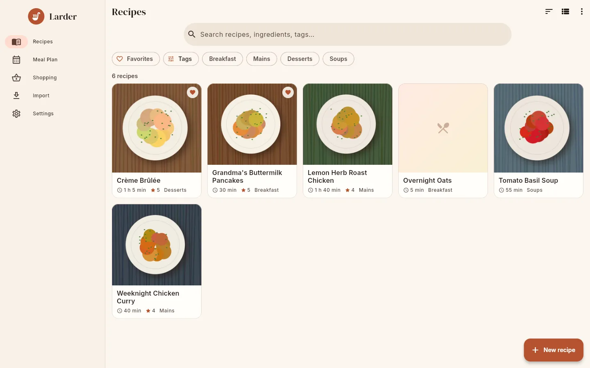
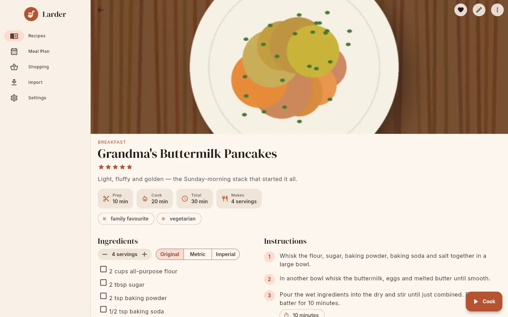
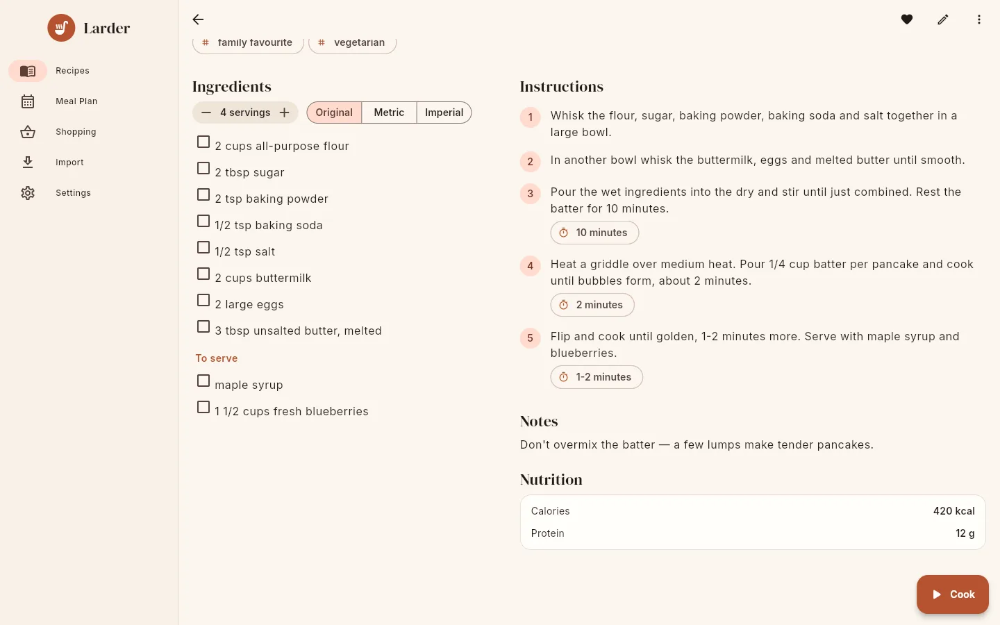
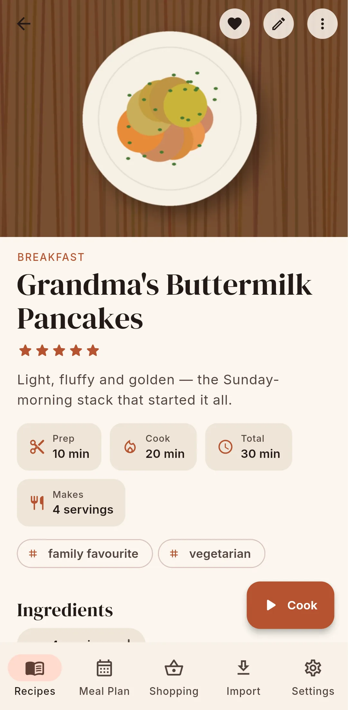
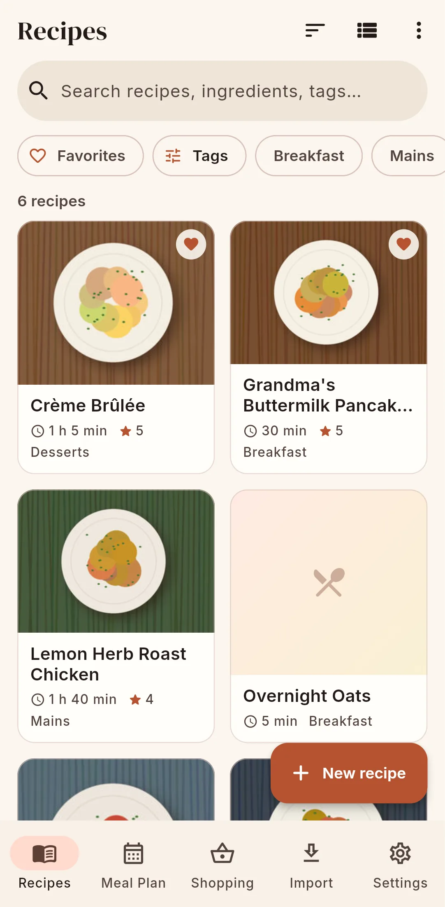

# Recipes

{ .screenshot }

## The recipe list

The **Recipes** screen shows every recipe in your household (or on your phone, in standalone
mode), with a count such as "6 recipes" above the results. Each card shows the photo, name,
total time, rating and first category, and a heart if it is one of *your* favourites.

Search, filtering and sorting all happen on the device, on the cached recipes, so they work
offline and are instant.

### How to search

Type in **Search recipes, ingredients, tags…**. Every word you type must appear somewhere in
the recipe's name, description, ingredients, tags or categories (in standalone mode the source name is
searched too). Search
ignores case and accents: `creme brulee` finds "Crème Brûlée". Clear the search with the **×**.

### How to filter

The chip row under the search bar:

- **Favorites**: only recipes you have favourited. Favourites are personal; each household
  member has their own.
- **Tags**: opens a **Filter** sheet with all **Categories** and **Tags**, most used first.
  Select as many as you like; a recipe must have *all* selected tags and categories. **Clear**
  removes them.
- The next chips are your eight most used categories. Tap one to filter by it. Selected
  categories and tags appear as chips with a **×** to remove them.

If nothing matches you see **No matching recipes** and a **Clear filters** button.

### How to sort

The sort button in the top bar offers:

| Option | Order |
|---|---|
| **Name (A–Z)** | Alphabetical (default) |
| **Name (Z–A)** | Reverse alphabetical |
| **Recently updated** | Last edited first |
| **Recently added** | Newest first |
| **Highest rated** | By star rating, then name; unrated last |
| **Quickest** | By total time (or prep + cook), then name; recipes without times last |

The next button switches between **Grid view** and **List view**. The **⋮** menu has
**Export cookbook** and, when connected to a server, **Sync now**. Pull down to refresh (sync)
on a touch screen.

### How to add a recipe

Tap **New recipe** (bottom right) to open the [editor](editing.md), or use
[Import](importing.md). An empty collection shows **Your cookbook is empty** with **New
recipe** and **Import** buttons.

## The recipe page

{ .screenshot }

From top to bottom:

- **Photo** (if any).
- **Categories** in capitals, the **name**, the **star rating** and the **description**.
- Info tiles: **Prep**, **Cook**, **Total** and **Makes** (the yield, for example
  "4 servings"). Total shows the entered total time, or prep + cook if no total is set.
- **Source**: the source name (or the website's host name) as a link to the source URL.
- **Tags** as chips.
- **Ingredients**, with the servings stepper and the **Original / Metric / Imperial** toggle.
  See [Scaling & units](scaling.md). Tap an ingredient (or its checkbox) to tick it off while
  you gather things; ticks are not saved.
- **Instructions**: numbered steps, grouped under section headings if the recipe has them.
  Durations found in a step ("10 minutes") are shown as timer chips; you can start them in
  [cook mode](cook-mode.md).
- **Notes** and **Nutrition**, if present.

On wide screens (960 px and more) ingredients and instructions sit side by side.

{ .screenshot }

### Top bar actions

| Button | What it does |
|---|---|
| **♥** | **Add to favorites** / **Remove from favorites** (for you only) |
| **✎** | **Edit** the recipe |
| **⋮ → Add to meal plan** | Pick a date, a meal (Breakfast, Lunch, Dinner, Snack) and servings (prefilled with the servings currently shown), then **Add** |
| **⋮ → Add to shopping list** | Pick a list or **New list…**, confirm the servings, and the ingredients are scaled and merged into the list |
| **⋮ → Duplicate** | Creates "*Name* (copy)" with its own copy of the photo, and opens it. Needs a server connection in connected mode. |
| **⋮ → Share** | Shares the name, description and source URL as text through the system share sheet |
| **⋮ → Open source** | Opens the source URL (only shown when there is one) |
| **⋮ → Delete** | After confirmation ("will be removed for everyone in your household") the recipe and its photo are deleted |

The **Cook** button (bottom right) opens [cook mode](cook-mode.md) at the servings currently
shown.

{ .screenshot }
{ .screenshot }

## Recipe addresses

Every recipe has a URL-friendly **slug** made from its name: lower case, accents removed,
anything that is not a letter or digit replaced by `-`, at most 80 characters (for example
"Crème Brûlée!" becomes `creme-brulee`). If the slug is already taken in your household, `-2`,
`-3` and so on are appended. The slug changes when you rename the recipe. The app links to
recipes by their id (`/recipes/<id>`); the API accepts either the id or the slug.

## Who can change what

Recipes belong to the household. Every member can view, edit and delete every recipe; there
are no per-recipe permissions. Favourites and the unit preference are personal.
