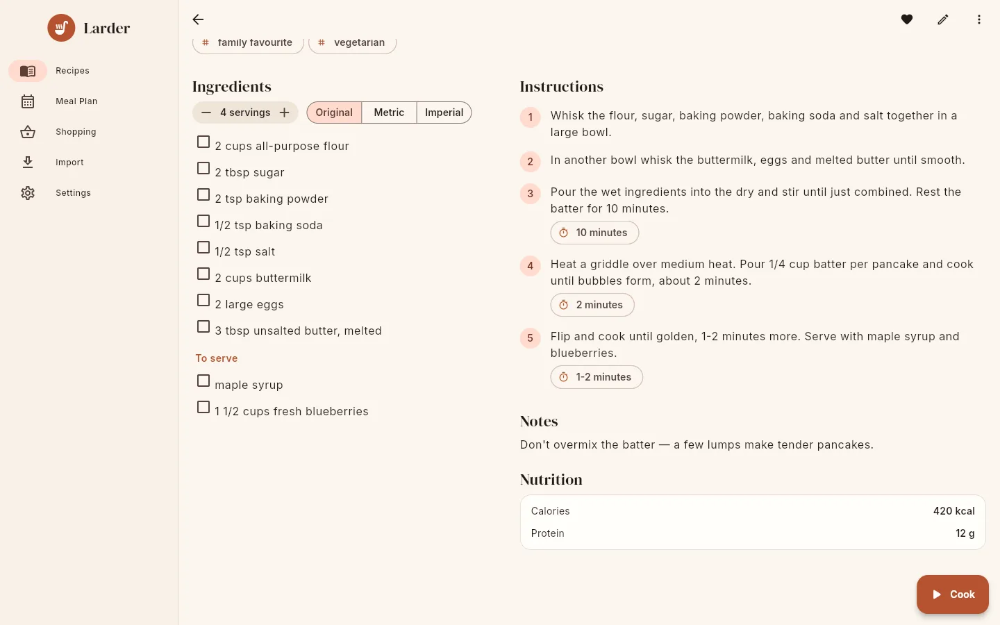

# Scaling & units

On every recipe page the **Ingredients** panel starts with two controls:

{ .screenshot }

## How to scale a recipe

Use the **− 4 servings +** stepper. It starts at the recipe's yield and shows the yield unit
("servings", "cookies", "loaf"…).

- Above 1, each tap changes the amount by 1. At 1 or below it changes by ½, down to a minimum
  of ½.
- Every measured ingredient is multiplied by *chosen servings ÷ recipe yield*. Ranges are
  scaled at both ends ("2–3 cloves" becomes "4–6 cloves" when doubled).
- If the recipe has **no yield**, the stepper shows a multiplier instead (for example
  "1 ×", "2 ×") and quantities are multiplied by that number.

The scale applies to the page you are looking at and to [cook mode](cook-mode.md) if you open
it from there. It is not saved.

!!! note "What is not scaled"

    Ingredients without a parsed quantity and food, such as "salt to taste" or a line the
    parser could not understand, are always shown exactly as written.

When the scale is 1 and units are **Original**, every ingredient is shown exactly as stored
(Larder tidies lines when a recipe is saved; see
[Editing recipes](editing.md#how-larder-tidies-ingredient-lines)). As soon as you scale or
convert, the app rebuilds the text from the parsed parts: the amount in bold, then the food,
then the note after a comma ("**1½ cups** flour, sifted").

## How to switch units

The **Original / Metric / Imperial** toggle converts measurable ingredients for this recipe.
The starting value comes from your **Units** preference in [Settings](settings.md) (stored in
your server profile when connected, on the device when standalone).

| Choice | Behaviour |
|---|---|
| **Original** | No conversion. |
| **Metric** | US volume and weight units become ml / l and g / kg. Metric amounts stay as they are. |
| **Imperial** | Metric volume and weight units become US units. Imperial amounts stay as they are. |

Only volume and weight convert. Counts (cloves, cans, slices, pinches, bunches and so on) and
unknown units are left alone. Volume is never converted to weight or the other way round, so
"2 cups flour" becomes "473 ml flour", not grams.

### Units picked when converting

The app uses exactly the same conversion and formatting rules as the server and the printed
cookbook, so a recipe shows the same amounts on screen and in the PDF.

=== "Metric"

    | Amount | Shown in | Rounded to |
    |---|---|---|
    | Volume under 1000 ml | ml | nearest 5 from 100 ml, whole numbers from 10 ml, one decimal below |
    | Volume of 1000 ml or more | l | two decimals |
    | Weight under 1000 g | g | nearest 5 from 100 g, whole numbers from 10 g, one decimal below |
    | Weight of 1000 g or more | kg | two decimals |

    For example 2 cups becomes `475 ml` (473.2 ml rounded to the nearest 5).

=== "Imperial"

    | Amount | Shown in |
    |---|---|
    | Volume under about 14.3 ml (just under 1 tbsp) | tsp |
    | Volume under ¼ cup | tbsp |
    | Volume from ¼ cup to under 4 cups | cup |
    | Volume from 4 to under 16 cups | quart |
    | Volume of 16 cups or more | gallon |
    | Weight under 16 oz | oz |
    | Weight of 16 oz or more | lb |

Every volume and weight unit Larder knows converts, including fl oz, pints, cl, dl and mg.
Conversion factors: 1 tsp = 4.92892 ml, 1 tbsp = 14.7868 ml, 1 fl oz = 29.5735 ml,
1 cup = 236.588 ml, 1 pint = 473.176 ml, 1 quart = 946.353 ml, 1 gallon = 3785.41 ml,
1 oz = 28.3495 g, 1 lb = 453.592 g. See
[Ingredient parsing & units](../reference/ingredients.md#conversion).

## How numbers are written

Amounts are written as kitchen fractions where that reads naturally: a fractional part within
0.02 of an eighth or a third is shown with a fraction character (`1½`, `⅓`, `2¾`); within 0.03
of a whole number the amount is rounded to it; otherwise up to two decimals are shown
(`0.1`). From 20 upwards, at most one decimal. Ranges use a dash: `2–3`.

Units are pluralised when the amount shown is more than 1, using each unit's plural form
(cups, pints, quarts, gallons, cloves, cans, jars, packages, slices, pieces, sticks, bunches,
sprigs, handfuls, heads, drops, pinches, dashes); abbreviations such as tbsp, fl oz, oz, g and
ml never change.

## Scaling elsewhere

- **Add to meal plan** remembers the servings; adding a week to a shopping list scales each
  recipe to its planned servings. See [Meal planner](meal-plan.md).
- **Add to shopping list** asks for the servings and scales before merging. See
  [Shopping lists](shopping.md).
- The [printable cookbook](cookbook.md) has its own **Units** option and always prints recipes
  at their original yield.
