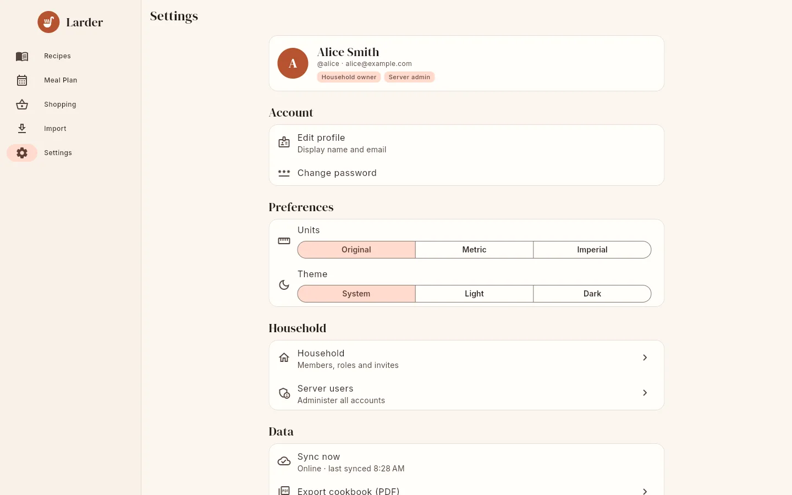

# Settings

The Settings screen looks different in connected mode (signed in to a server) and in
standalone mode.

{ .screenshot }

## Profile card

- **Connected**: your initial, display name, `@username`, email, and badges **Household
  owner** or **Member**, plus **Server admin** if you are one.
- **Standalone**: **On this device**, "Everything is stored on this phone. No account
  needed.", and the **Connect to a server…** button. See
  [Standalone mode](standalone.md#connecting-to-a-server-later).

## Account (connected only)

**Edit profile** ("Display name and email")
:   Change your **Display name** (1–100 characters) and **Email**. Leave **Email** empty to
    remove your address. Changes need a connection.

**Change password**
:   **Current password** ("Leave empty if you only sign in with SSO"), **New password** and
    **Confirm new password**. The new password must be at least 8 characters and both entries
    must match. Changing your password signs out all your **other** sessions (other devices
    and browsers); the device you change it on stays signed in. Accounts created through single sign-on have no password until you set one
    here, which then lets you sign in with username and password too.

## Preferences

**Units**
:   **Original**, **Metric** or **Imperial**: the default unit system on recipe pages, in cook
    mode and on the cookbook screen. Connected: saved in your server profile, so it follows you
    to other devices. Standalone: saved on the device. See [Scaling & units](scaling.md).

**Theme**
:   **System**, **Light** or **Dark**. Saved on this device only.

**AI assistant** (standalone only)
:   Set up your own AI provider and key. See [AI assist](ai.md).

## Household (connected only)

**Household**
:   "Members, roles and invites" for owners, "Members" for others. See
    [Households & sharing](households.md).

**Server users** (server admins only)
:   "Administer all accounts". See [Users & administration](../admin/users.md).

## Data

**Sync now** (connected only)
:   Sends pending changes and fetches updates. The subtitle shows **Online** or **Offline**,
    the time of the last sync, the number of pending changes and the last error, if any. See
    [Offline use & sync](offline.md).

**Export cookbook (PDF)**
:   Opens the [printable cookbook](cookbook.md) screen.

**Export all as JSON backup**
:   Makes a zip of all recipes and photos. See [Backup & restore](backup.md).

## Server (connected only)

The first row shows the server address and "Larder *version* · *database*" (`sqlite` or
`postgres`).

**Change**
:   - **Web**: enter another **Server URL** and **Connect**. If it is a different server, you
      are signed out and the cached data is cleared.
    - **Android**: after confirming **Change server?** ("You will be signed out and the
      recipes saved on this device will be removed.") you are signed out and returned to the
      server address screen.

**Disconnect and use on this device only** (Android only)
:   "Keeps your recipes and downloads their photos". Switches to standalone mode. See
    [Standalone mode](standalone.md#disconnecting-from-a-server).

**Sign out**
:   Asks **Sign out?** first. The warning says either "Your offline copy of recipes on this
    device will be removed." or, if there are unsynced changes, "You have N changes that have
    not synced yet. They will be lost." Signing out deletes the cached recipes, meal plan,
    lists and pending changes from the device and revokes the session on the server.

## About

**Larder**
:   The app version and build number, and the server version when connected.

**Open source licenses**
:   The licenses of the app and the libraries and fonts it uses.
