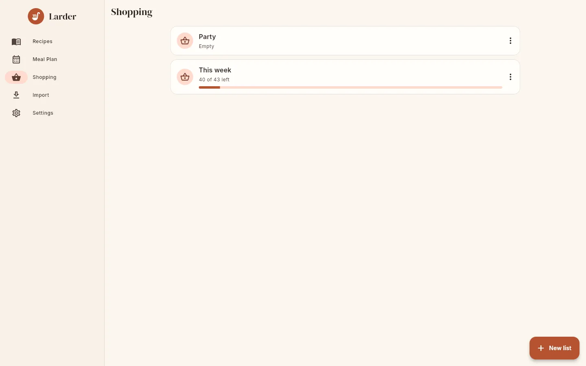
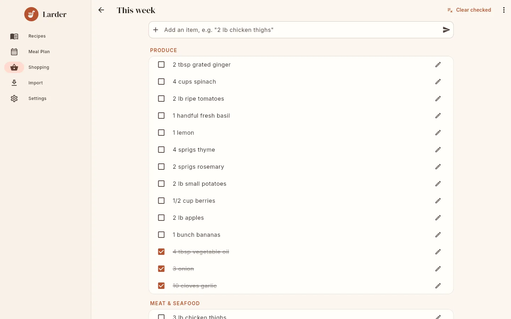
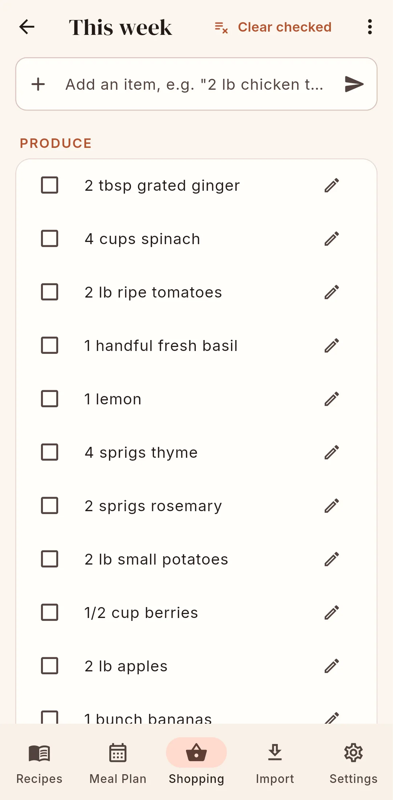

# Shopping lists

The **Shopping** screen lists your household's shopping lists, most recently changed first.
Each shows how many items are left ("40 of 43 left", **Empty** or **All done!**) and a
progress bar.

{ .screenshot }

## Managing lists

- **New list** creates a list (the name defaults to "Groceries"; up to 100 characters) and
  opens it.
- The **⋮** menu on a list has **Rename** and **Delete**.
- You can have as many lists as you like, for example "This week" and "Party".

## Inside a list

{ .screenshot }

Items are grouped under supermarket aisles in a fixed order: Produce, Meat & Seafood,
Dairy & Eggs, Bakery, Pantry, Baking, Spices & Seasonings, Canned & Jarred, Frozen, Beverages,
Household, Other. Within an aisle, unchecked items come first, then checked ones, in the order
they were added.

### How to add an item

Type in **Add an item, e.g. "2 lb chicken thighs"** and press Enter or the send button. The
text is parsed like an ingredient line, so "2 lbs apples" becomes 2 lb of apples,
and the item is placed in an aisle automatically (apples → Produce; anything bought by the can or jar → Canned & Jarred). See
[aisle classification](../reference/ingredients.md#aisles).

### How to tick items off

Tap the checkbox. Checked items are struck through and move to the bottom of their aisle.
**Clear checked** (top bar, shown when something is checked) deletes all checked items.

### How to edit or delete an item

- **✎** ("Edit item") opens a dialog with **Item**, **Quantity**, **Unit**, **Note** and
  **Aisle**. Change the aisle here if the automatic choice is wrong. **Delete** removes the
  item.
- Swipe an item to the left to delete it.

### Rename or delete the list

The **⋮** menu in the list's top bar has **Rename** and **Delete list**.

{ .screenshot }

## How to add a recipe's ingredients

On a recipe page choose **⋮ → Add to shopping list**:

1. Pick a list, or **New list…**.
2. Confirm the number of servings (prefilled with the servings shown on the recipe page).
3. The ingredients are scaled and merged into the list: "Ingredients added to your shopping
   list".

To add a whole week of planned meals, use the cart button on the
[Meal Plan](meal-plan.md#how-to-shop-for-the-week).

## How ingredients are merged

Larder adds recipe ingredients to a list with the same rules on the server and on the phone:

- **Scaling.** Quantities are multiplied by *servings ÷ recipe yield* when both are known.
  For a range ("2–3 cloves") the upper value is used.
- **Same food.** An ingredient is merged into an existing item when the item is **not
  checked** and has the same food, ignoring case, accents and singular/plural ("egg" and
  "eggs", "tomato" and "tomatoes"). Because ingredient lines are
  [tidied](editing.md#how-larder-tidies-ingredient-lines) when recipes are saved, "large
  eggs" and "eggs, beaten" are both just "eggs" and merge too.
- **Compatible units.** Units are compatible when they are the same, or both are volume units,
  or both are weight units. Amounts are converted into the existing item's unit before adding
  (1 lb flour + 8 oz flour = 1.5 lb flour). If one side has a unit and the other has none,
  they only merge when one of them has no quantity ("milk" + "1 cup milk").
- **Otherwise** a new item is added, with its aisle classified from the food name.
- Each item remembers which recipes it came from.
- Ingredients with neither a parsed food nor any text are skipped; unparsed lines are added
  as items with the whole line as the name.
- Merged totals are tidied: they move to a sensible unit of the same system (teaspoons →
  tablespoons below ½ cup → cups → quarts; ounces → pounds; grams → kilograms; millilitres →
  litres) and are rounded **up** to a kitchen-friendly step (¼ tsp, ½ tbsp, ¼ cup, ½ oz, ¼ lb,
  5–10 g/ml, 0.1 kg/l). For example, 73 tbsp of butter becomes "4 3/4 cups butter" and 12⅝ tsp of
  salt becomes "4 1/2 tbsp salt". Rounding up means you may buy slightly more, never less.

Examples:

| Already on the list | Added | Result |
|---|---|---|
| 2 cups milk | 1 ¼ cups milk | 3 ¼ cups milk |
| 1 lb flour | 8 oz flour | 1 ½ lb flour |
| 2 eggs | 2 eggs | 4 eggs |
| 1 egg | 3 large eggs | 4 eggs |
| 1 cup flour | 100 g flour | two items (volume and weight do not mix) |
| 3 onions *(checked)* | 1 onion | a new unchecked "1 onion" |

!!! note "Offline"

    In connected mode, adding an item while offline shows it immediately (in **Other** until
    the server assigns its aisle) and syncs later. Adding a recipe or a week of meals while
    offline is queued, but the list only shows the merged result after it has synced.
