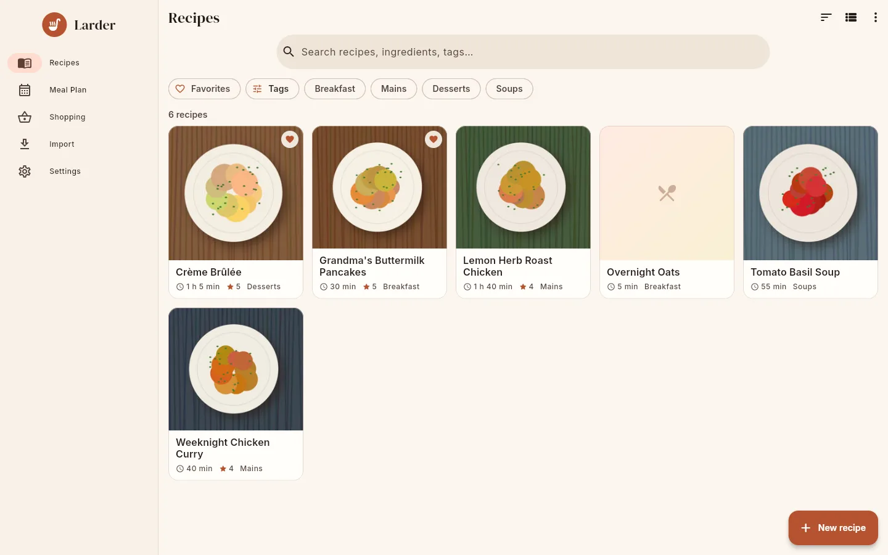
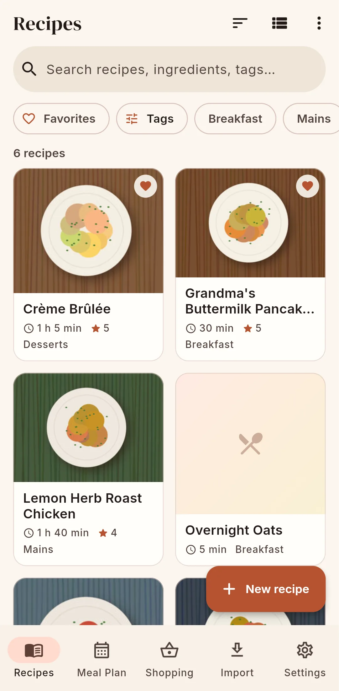
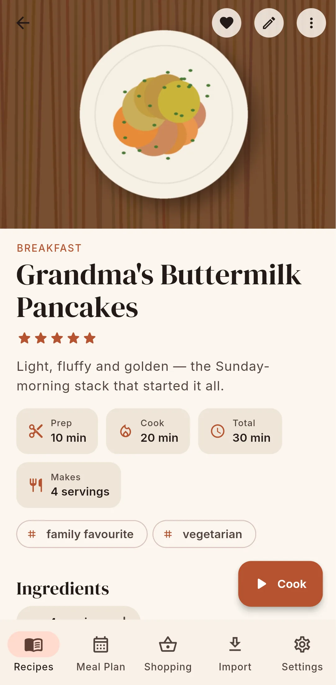
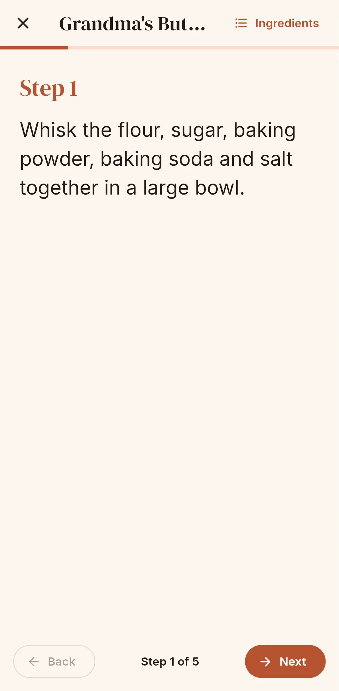
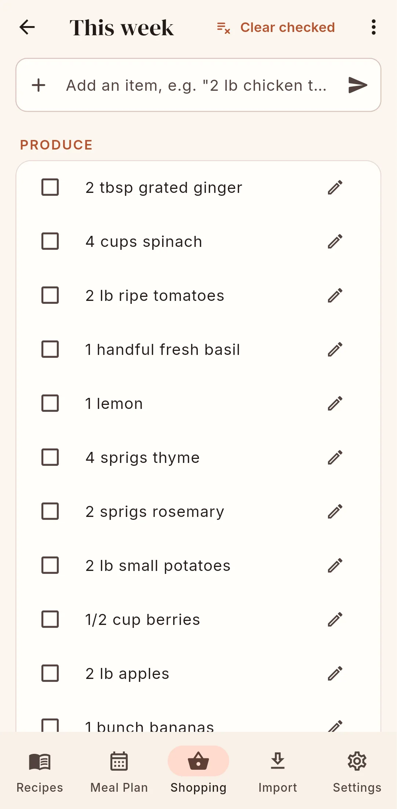

{ width="96" }

# Larder

A recipe manager and cookbook for Android and the web, with or without a server.
{ .tagline }

[Get started](getting-started/index.md){ .md-button .md-button--primary }
[User guide](guide/index.md){ .md-button }

{ .screenshot }

Larder keeps your family's recipes in one place: structured ingredients you can scale and
convert, step-by-step cook mode with timers, a weekly meal planner, shopping lists sorted by
supermarket aisle, and a typeset, printable cookbook. It is one Flutter app that runs as a
native Android app and as the web UI of a small, fast Rust server.

## What it does

-   :material-book-open-page-variant-outline:{ .lg .middle } **Recipes**

    ---

    Ingredients with sections, quantities, ranges and units; steps; photos; tags, categories,
    ratings, notes, nutrition and source links. Accent-insensitive search, filters and favourites.

    [:octicons-arrow-right-24: Recipes](guide/recipes.md)

-   :material-scale-balance:{ .lg .middle } **Scaling & units**

    ---

    Scale to any number of servings and show quantities in the original units, metric or
    imperial, with kitchen-friendly fractions (1 ½ cups).

    [:octicons-arrow-right-24: Scaling & units](guide/scaling.md)

-   :material-chef-hat:{ .lg .middle } **Cook mode**

    ---

    A full-screen, one-step-at-a-time view that keeps the screen awake, with timers detected
    from the instructions ("bake for 25 minutes").

    [:octicons-arrow-right-24: Cook mode](guide/cook-mode.md)

-   :material-calendar-week:{ .lg .middle } **Meal planner**

    ---

    Plan breakfast, lunch, dinner and snacks week by week, with recipes or free-text entries
    such as "Leftovers".

    [:octicons-arrow-right-24: Meal planner](guide/meal-plan.md)

-   :material-basket-outline:{ .lg .middle } **Shopping lists**

    ---

    Add whole recipes or a week of meals: ingredients are scaled, merged across recipes and
    grouped by aisle.

    [:octicons-arrow-right-24: Shopping lists](guide/shopping.md)

-   :material-download-outline:{ .lg .middle } **Import**

    ---

    Mealie (files or live server), Tandoor, Paprika, Nextcloud Cookbook, Recipe Keeper,
    schema.org JSON-LD, any recipe website, pasted text, and photos of recipe cards with AI.
    Imports are tidied and sorted into categories automatically.

    [:octicons-arrow-right-24: Importing](guide/importing.md)

-   :material-book-open-variant:{ .lg .middle } **Printable cookbook**

    ---

    A typeset PDF with title page, dedication, contents, chapters, running heads and an index,
    in three themes on Letter, A4 or A5.

    [:octicons-arrow-right-24: Printable cookbook](guide/cookbook.md)

-   :material-account-group-outline:{ .lg .middle } **Households**

    ---

    Share recipes, meal plans and lists with your family. Invite codes, household owners,
    server administrators and optional single sign-on (OIDC).

    [:octicons-arrow-right-24: Households](guide/households.md)

## Standalone or connected

Larder can run in two ways, and you can switch between them later.

!!! note "Standalone (Android only)"

    Choose **Use on this device** on first launch. No account, no server: everything is stored
    on the phone, and imports, shopping-list merging, AI assist (with your own API key) and the
    cookbook PDF all run on the phone through the same Rust engine the server uses.

!!! note "Connected (Android and web)"

    Run the self-hosted server (Docker or a single binary, SQLite or PostgreSQL) and share
    with your household. The app is offline-first: data is cached on the device and changes
    made offline are queued and synced when the connection returns.

A standalone app can be **connected to a server later**: it uploads everything once,
resumably, and can skip recipes that already exist. You can also **disconnect** and keep your
data on the phone. See [Choosing how to run Larder](getting-started/choosing.md).

{ .screenshot }
{ .screenshot }
{ .screenshot }
{ .screenshot }

## Get started

-   :material-server-outline: **Self-host the server**

    ---

    One Docker Compose file, SQLite by default or PostgreSQL with an overlay.

    [:octicons-arrow-right-24: Install the server](getting-started/server.md)

-   :material-android: **Install the Android app**

    ---

    Sideload the APK from GitHub Releases and pick standalone or connected.

    [:octicons-arrow-right-24: Install the Android app](getting-started/android.md)

-   :material-rocket-launch-outline: **First steps**

    ---

    Create the admin account, invite your family and import your first recipes.

    [:octicons-arrow-right-24: First steps](getting-started/first-steps.md)

-   :material-api: **Build on it**

    ---

    A documented JSON HTTP API and an on-device engine with a small C ABI.

    [:octicons-arrow-right-24: Reference](reference/index.md)

Larder is open source under the MIT license.
